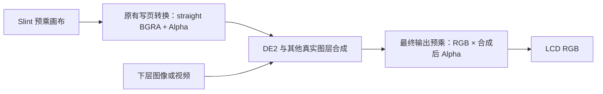

# NX1 透明合成修复（2026-10-21）

本轮针对已准入的 NX1 / sun8i、Linux `3.4.39 #1 Fri Mar 25 14:53:50 CST 2022`，
1024×600 BGRA8888 双页。沿用 [参考 PAN 约定](nx1-framebuffer.md)，不改变翻页完成边界。
修复位于 [NX1 板级合成会话](../src/backends/nx1/composition.rs)，不改 UI、通用像素转换或其他设备。

## 复现与定位

showcase 的 Layers 页关闭图片背景，调低 Overlay opacity 后，LCD 仍显示明亮绿圈，
低档位有明显同心色带。有图片背景时表现正常。
通过原生 MCP 固定背景开/关以及 3%、25%、75%、100% 四档，等待 UI 与提交线程空闲后，
以 4 KiB 分块读取静止物理前台页；每次读前后核对页偏移。
用户确认 3% 时 LCD 的异常外观与物理页的纯 RGB 诊断图一致。

透明模式的中心像素如下。最后一列是 Alpha 合成到黑底的数学参考，**不是 LCD 数字采集结果**：

| Opacity | framebuffer straight RGBA | 预期最终 RGB（黑底参考） |
| --- | --- | --- |
| 3% | (85, 255, 170, 6) | 约 (2, 6, 4) |
| 25% | (99, 255, 206, 62) | 约 (24, 62, 50) |
| 75% | (99, 255, 209, 188) | 约 (73, 188, 154) |
| 100% | (100, 255, 208, 251) | 约 (98, 251, 205) |

滑块确实改变 Alpha；共用写页路径把 Slint 预乘 RGB 反预乘为 straight BGRA。
在很低的 Alpha 下，整数舍入会使恢复出的 RGB 出现色阶，但正常最终合成会按 Alpha 衰减这些颜色。
有不透明图片背景时，Slint 已在 CPU 中完成混合，输出 Alpha 为 255，所以不会暴露这个问题。
重复 `3% → 75% → 25% → 3%`，覆盖页偏移 0、600，3% 图像区域逐字节一致，排除了本次静态现象的旧页残留。

## 具体原因

实际显示层是 ch2/layer0，ARGB8888、pixel alpha、非预乘输入，与 framebuffer 字节含义一致。
仅有该通道启用，路由到混合器输入 0。实际读取的 DE2 寄存器为：

| 物理地址 | 原值 | 含义 |
| --- | --- | --- |
| `0x01101000` | `0x00000101` | 仅输入 0 启用，保留既有填充配置 |
| `0x01101080` | `0x00000002` | 输入 0 来自通道 2 |
| `0x01101084` | `0x00000000` | 非预乘输入模式 |
| `0x01104000` | `0xff000001` | ch2/layer0 启用，pixel alpha、ARGB8888 |
| `0x011010fc` | `0x00000000` | 最终输出预乘关闭 |

该固件的 `de_rtmx_set_outitl` 在 `0xc0174508` 执行清除输出控制 bit 0 的指令；
显示管理器启用路径会调用它。镜像 SHA256 与 [内核分析记录](nx1-framebuffer.md#实际内核的完成接口) 一致。
[全志参考实现](https://github.com/allwinner-zh/linux-3.4-sunxi/blob/master/drivers/video/sunxi/disp2/disp/de/lowlevel_sun8iw6/de_rtmx.c)
也在设置交错模式时将 `bld_out_ctl.premultiply_en` 设为 0。
参考源码仅辅助解释，地址与指令结论来自当前固件镜像，行为由实机单变量验证确认。

LCD 接收最终 RGB。关闭最终预乘时，透明合成结果中的 straight RGB 没有获得最终 Alpha 衰减，
用户看到了亮色及低 Alpha 取整色圈。仅把 `0x011010fc` 的 bit 0 从 0 改为 1，
不修改任何 framebuffer 字节、图层 Alpha 或 UI，用户即确认低透明度变暗、异常消失。
正常 PAN 后读回仍为 1，说明修复不依赖改写页面内容。

当真实下层不透明时，合成后 Alpha 为 255，最终乘法不会再使合成结果变暗。
单个透明图层也能得到正确的最终亮度。图层内的 Alpha 和与下层的混合继续保留。

## 实现范围与退出

NX1 已通过固件、独占所有权和 framebuffer 布局检查后，首次写页前获取 `/dev/mem` 映射。
映射从 `0x01101000` 开始、长度 `0x4000`，用于核验输出和当前 UI 通道；
**唯一写入的寄存器是 `0x011010fc`，唯一改变的是 bit 0**。
不写 framebuffer、图层路由、背景色、DMA、IRQ 或时序寄存器。

先核验输出与 UI 尺寸、straight ARGB8888 / pixel alpha 输入以及逐行模式，再启用最终预乘并读回。
每次参考 PAN 前后继续检查；配置变化或权限不足时返回错误，不提供透明显示错误的软件回退。
映射由显示会话持有；提交线程结束、最后一个会话引用释放时，在仍持有独占锁的条件下恢复进入前的输出值。
若配置已经被其他操作改变，则不覆盖新状态。强杀进程不执行 Rust 析构，不作为恢复验证。

本修复没有固定黑底，没有修改输入的透明像素，也没有增加全屏缓存、物理页或在途提交。
其他板级实现不访问这些寄存器。运行权限和命令见 [NX1 设备说明](../test-app/devices/nx1/README.md)。

## 验证

主机回归使用内存文件替代 MMIO，检查初始化、运行中拒绝异常和析构恢复：

- 旧的“保持输出预乘关闭”行为会使透明输出回归失败；启用 bit 0 后通过。
- 原值为 0 和 1 时均正确管理生命周期；整段寄存器比较确认只修改输出控制字。
- 两路输入、非黑背景和蓝色下层配置均保留；布局、全局 Alpha、预乘输入或交错模式不符合条件时不写寄存器。
- 运行中输出模式、尺寸或输入 Alpha 模式改变时检测失败，析构不覆盖改变后的配置。

实机单变量测试随后临时启用独立的蓝色硬件下层 ch1/layer0，使用单层 `DISP_LAYER_SET_CONFIG`，
没有调用 HWC，没有分配 DMA 或向 UI 的 framebuffer 加背景。用户确认蓝底可见、拖动透明度正常。
验证结束恢复该层原本关闭的状态。该测试证明真实硬件图层叠加，不代表视频解码或业务视频所有权集成已经完成。

正式实现还完成以下检查：

| 检查 | 结果 |
| --- | --- |
| 八种 feature workspace 矩阵、互斥拒绝、fmt | 通过 |
| NX5/MCP 主机与 NX1/MCP ARM 全 targets Clippy | 通过 |
| NX1 release 交叉构建 | 通过 |
| 正式版八组背景/透明度物理页对照 | 图像区域 RGBA 全部逐字节一致，透明模式仍有 Alpha=0 |
| 20 秒有限运行 | 退出 0，输出位从 0→1→0，设备引用释放 |
| 不存在的触摸设备路径 | 按预期退出 1，输出模式恢复为 0 |
| 运行中把输出位改回 0 | 按预期报 `NX1 final output alpha is disabled` 并退出 1，停止提交 |

八组物理帧中，差异仅位于背景开关按钮与滑块的交互显示区域；两轮鼠标/焦点历史未统一，
不将其称为整帧逐像素一致。排除这两个控件区域后，其余 RGBA 全部一致。
正式版在该轮正常交替提交后，最终输出预乘位始终为 1。

正式常驻程序位于 `/mnt/nx1-alpha-fix-zv98b98v/showcase-fixed`，SHA256 为
`691fc2d04af224ee2a8985ef4e31ae85442e6b6740dabb1e2e9322c0b394c6f0`。
该路径是本轮部署记录，操作前仍须重新核对进程、挂载和文件摘要；原二进制、字体和恢复资料保留。

原始数据及诊断脚本保存在本地忽略目录 `evidence/nx1-opacity/2026-10-21/` 和
`evidence/nx1-alpha-fix/2026-10-21/`，检出仓库后需另行取得。
前者保存修复前物理像素及重复性记录，后者保存修复验证；不把物理页读取当成 LCD 数字采集或无撕裂认证。
