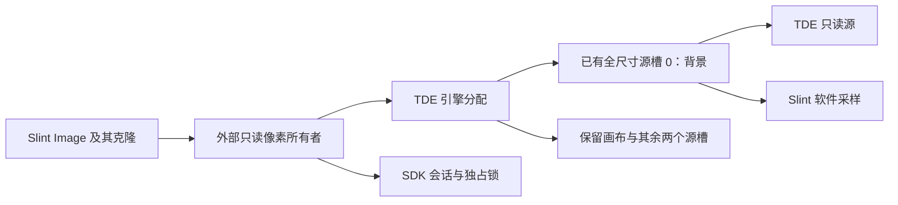

# NX5：复用已有 MMA 源槽保存背景

2026-10-16 在 NX5 #233、1024×600、无旋转下验证。**同一 ELF 的普通背景与 MMA 背景相比，预热后 RSS 减少 2,032 KiB，匿名内存减少 2,404 KiB；MMA 分配保持不变。**

验证版显式启用 `nx5-mma-background` 和 `--mma-background`，不改变普通模式的存储选择。
构建与运行入口见 [验证版说明](../test-app/devices/nx5/mma-background/README.md)，当前 API 约束见 [平台说明](software-platform.md)。

## 实现与生命周期

一块原有全尺寸 MMA 源槽固定为只读背景，其他图片使用剩余全尺寸槽及紧凑槽。
初始化先解码、复制一次并刷新 cache；此后 Slint 图像、软件采样和 TDE 都引用同一份像素。
背景直接复制不再上传，改变透明度、缩放或源视图时按原有软件路径处理。

图像所有者保留引擎和 SDK，会话不会先于映射释放；修改 `SharedPixelBuffer` 时先复制到普通堆。
已知完成状态的失败仍禁用 TDE 并整帧软件重绘；未知 DMA 仍保留资源，禁止继续提交。
双 framebuffer、完成契约和一帧预渲染未改变。

首轮发现：仅替换 `.slint` 的背景属性不能节省内存。
编译器在组件初始化时已执行默认图片解码，资源缓存继续保留 2,404 KiB 匿名映射；首轮 MMA RSS 为 19,392 KiB，对照为 18,528 KiB。
修正版将背景选择放到应用初始化阶段，`showcase::configure` 仅在应用没有提供背景时加载普通图片，避免提前生成旧副本。
首轮失败证据单独保留，没有用修正结果覆盖它。

## 同版本内存对照

三种模式均运行 100 秒，使用相同 ELF、字体、SDK、MCP 和设备参数。
按相同顺序进入 Controls、Rich list，再返回 Controls，采样发生在截图之前。

| 指标（KiB） | 普通背景 | MMA 背景 | MMA + 软件回退 |
| --- | ---: | ---: | ---: |
| RSS | 18,272 | 16,240 | 15,856 |
| RssAnon | 7,760 | 5,356 | 5,356 |
| `[heap]` RSS | 3,840 | 3,840 | 3,840 |
| 匿名映射 RSS | 3,592 | 1,188 | 1,188 |
| MMA 总分配 | 12,760 | 12,760 | 12,760 |
| MMA 块数 | 6 | 6 | 6 |

普通与 MMA 模式的匿名映射差为 **2,404 KiB**，对应 2,400 KiB 背景像素及分配页开销。
MMA 模式多触及 232 KiB ELF 页及 140 KiB libc 页，因此 RSS 净下降 **2,032 KiB（1.98 MiB，约 11.1%）**。
这两项差额来自 `smaps` 分组，不把所有 RSS 变化直接等同于像素分配变化。

MMA 构成仍为：画布 2,400 KiB、两个全尺寸源槽各 2,420 KiB、紧凑槽 620 KiB、双 framebuffer 4,800 KiB、vppu 100 KiB。
背景复用其中一个 2,420 KiB 源槽，没有新增另一块。
MMA/fb 映射在本固件的 RSS 计数为零，不能把它们与 RSS 混为一项；ELF 位于 tmpfs，其文件驻留页与进程 RSS 重叠。
这些结果不能直接与历史版本的 17.43 MiB RSS 相减，也不代表任意页面或长时间运行后的固定占用。

## 显示、回退与释放

- 普通、MMA、MMA 回退三种模式的 Controls **物理前台页逐字节相同**，各 614,400 像素；与对应原生 MCP 软件参考图比较，RGB 和板级 alpha 编码均完全一致。
- MMA 模式的 Rich list 另检查 614,400 物理像素，最大通道误差 1，alpha 完全一致；覆盖其他图片使用剩余源槽后背景仍正确。
- Motion 稳态提交批次约 29 FPS。普通和 MMA 模式没有 TDE 错误；这是短时功能观察，不是完整性能基准。跨静态阶段的首个计数批次不作为动画 FPS。
- 软件回退在首次背景 DMA 提交前注入一次错误 `-10001`，完成状态明确。随后日志始终 `copy=0, blend=0, cache_hits=0, errors=1`，软件绘制、动画与导航继续运行，没有重建一份堆背景。
- 三个有限进程均退出 0，MMA 回到 4,900 KiB / 两块，释放 TDE 的全部四块分配；各自新增内核日志无 MMB 泄漏回收、强制 unmap 或强制关闭 VO。

主机普通 feature 矩阵、fmt、clippy、API 文档检查通过；补丁模式的 workspace 测试、clippy 和 API 文档检查通过。
外部像素测试覆盖所有者存活、写时复制及 showcase 八页的软件逐字节一致；原生 ASan/UBSan 检查覆盖固定槽不可改写、直接复制、不支持操作回退、未知 DMA 隔离及释放。
ARM release 构建完成。六个实机专用 ignored 测试未在此轮重跑；本轮没有新 WBC、实体触摸、旋转或 LCD 扫描无撕裂验证，也没有验证 Slint 其他语言 ABI 或其他 renderer。

## 构建及交付记录

Slint 基线 `c878901f`，外部像素补丁本地提交 `c49ec2918037c5dac3ec61302e7cfa618f32bd15`。
桥接层实现提交 `8bd65c7`（基线 `c43ddc9`），其他依赖保持原 `Cargo.lock` 锁定版本。
最终 ELF SHA256：`cdab572094a846ab6d0a0a89cba6e7a2fd279c7f569e3d9ffbc27ff72431870f`。

常驻程序为 `/tmp/slint-bridge-mma-v2-20261016/showcase`，由同目录 `start.sh` 启动，启用 MMA 背景，关闭 trace 与故障注入，不设置退出时限。
交付观察 PID 6837、Overview 页，唯一 framebuffer/触摸设备所有者；PID 只是采样快照，后续操作仍需重查。
原播放器和已有恢复资源保留，部署策略及目标快照同步更新。

原始证据位于本地忽略目录 `evidence/nx5-mma-background/2026-10-16/`，需要另行取得：`summary.json`、`v2-final/`、`analyze.py`、首轮与最终归档、主机测试日志及常驻进程快照。
分析脚本重放历史数据，不采集新设备状态。

## 2026-10-17 审查与兼容性修复

审查范围为桥接层 `c43ddc9..3197784` 和 Slint `c878901..c49ec29`，按规范与需求两个方向独立检查。
规范审查确认两项兼容性缺陷；需求审查独立确认其中的 MCU 影响。修复如下：

1. **普通像素缓冲无条件依赖 `Arc`。** 原补丁使无指针原子操作的 `thumbv6m-none-eabi` 编译失败。现在外部存储仅由 Slint 的 `unstable-external-pixel-buffer` feature 启用，并要求 `std`；普通模式保持原字段、大小和对齐。
2. **FFI 边界未完整支持外部存储。** 窗口截图导出仍读取原堆向量，会遗漏外部像素；C++ 绑定也不能直接表示新增所有者。此验证能力现在明确与 `ffi` 互斥，C++ 生成器只输出普通布局，不将未支持的外部存储传过 FFI。

已知完成状态失败时，画布和背景所有者继续存活，整帧软件重绘读取原外部像素；未知 DMA 时，现有 `Framebuffer` 隔离逻辑保留 SDK 会话和独占锁。
在文档允许的调用范围内，未发现提前释放 MMA 或未知完成状态下继续写页的缺陷。

新增回归覆盖外部像素跨线程保活、写时复制释放、部分画布写入后的整帧回退、后续透明度变化，以及未知 DMA 后拒绝继续绘制；这些是主机模拟器与所有权检查，不是真实 SDK 析构实验。
另验证原像素缓冲布局、使用修正后 Slint 的普通 `fbdev` 公开接口和四种旋转截图。
`thumbv6m` 的最小 `i-slint-core` 工程在修复前出现四处 `alloc::sync` 错误，修复后检查通过。
普通 FFI 构建检查通过，实验 feature 与 FFI 组合按预期拒绝。
完整头文件生成入口在 Qt 元数据阶段因缺少已解包依赖及缓存写权限失败；改为单独运行本次涉及的核心生成。
核心 C++ 图像绑定生成及 `g++` 语法、大小、对齐、比较操作检查通过；未执行完整 C++ 应用构建。

普通 feature 矩阵、格式、clippy、API 文档、补丁模式测试和 clippy、原生 ASan/UBSan 检查及 ARM release 构建通过。
本轮未操作 NX5/X9、未替换常驻二进制，也未重跑六个实机专用 ignored 测试；上文内存、像素和 PID 保持原采样日期及版本含义。
新增原始日志与复现工程记录位于本地忽略目录 `evidence/nx5-mma-review/2026-10-17/`，需要另行取得；当前构建命令以[验证版说明](../test-app/devices/nx5/mma-background/README.md)为准。

本轮 Slint 隔离修复提交：`93b2ee03af1e53300f4cb09e8138559973f728f9`；原实测仍对应上文 `c49ec29`，不改写为新提交的设备结果。

## 2026-10-17 修复版部署复测

本轮实际部署桥接层 `cae1f6c9`、Slint `93b2ee03`，同时启用 `nx5-mma-background`、`slint/unstable-external-pixel-buffer` 和 `slint/mcp`。
ARM release ELF SHA256 为 `733277125fd47762a27145f0807313f4573f85a354ebc83606695e4ae59eb2d6`。
设备重新核验为同一 NX5 #233、1024×600、无旋转，启动 ID `4aa4f5d2-8de2-42cb-9c2b-44c3e74d6e2b`。

同一 ELF 分别运行普通背景、MMA 背景、MMA 加已知完成状态的软件回退，每种模式 100 秒。
按相同顺序预热 Controls → Rich list → Controls，在截图前采三次内存；每种模式的三次 RSS 均相同。

| 指标（KiB） | 普通背景 | MMA 背景 | MMA + 软件回退 |
| --- | ---: | ---: | ---: |
| RSS | 18,556 | 16,012 | 16,012 |
| RssAnon | 7,760 | 5,356 | 5,356 |
| `[heap]` RSS | 3,840 | 3,840 | 3,840 |
| 匿名映射 RSS | 3,592 | 1,188 | 1,188 |
| MMA 总分配 / 块数 | 12,760 / 6 | 12,760 / 6 | 12,760 / 6 |

本轮 RSS 减少 **2,544 KiB（2.48 MiB，约 13.7%）**，其中背景对应的匿名映射减少 **2,404 KiB**。
其余净差 140 KiB 来自 ELF 与共享库驻留页变化；这不是比前一轮又节省了一份图片，不能直接用不同进程的历史 RSS 相减。
软件回退未重新保留普通堆背景，MMA 分配数量和总量不变。

三个 Controls 物理前台页各 614,400 像素，跨模式逐字节相同，与对应原生 MCP 软件参考的 RGB 和板级 alpha 编码完全一致。
MMA 模式另检查富列表 614,400 物理像素，最大通道误差 1、alpha 完全一致。
Motion 稳态提交批次约 29 FPS；跨静态阶段的第一个批次不作为动画 FPS。
软件回退模式仅在提交背景 DMA 前注入一次 `-10001`，随后持续 `copy=0, blend=0, cache_hits=0, errors=1`，导航与动画正常。
这验证了完成状态明确时的回退，没有在实机注入未知 DMA。

三个测试进程均退出 0，MMA 回到 4,900 KiB / 两块；新增内核日志无 MMB 泄漏回收、强制 unmap 或强制关闭 VO。
切换前旧常驻程序在静态页、提交线程空闲时用 SIGTERM 停止，其内核强制回收记录单独保存，不计入新版本正常退出结果。
本轮没有新的 WBC、实体触摸或旋转扫描验证。

修复版已通过 `start.sh` 常驻 `/tmp/slint-bridge-mma-fixed-20261017/showcase`，观察 PID 16705、PPid 1、Overview 页，独占 framebuffer 与触摸设备。
不设退出时限，关闭 trace 和故障注入。上一 MMA 版保留为恢复程序，播放器及共享字体/SDK 仍保留。
为满足内存余量，非当前、非恢复版本的旧 `2fddc04` showcase 已按原 SHA256 归档到主机，不再占设备 tmpfs；它不是本轮恢复程序。

新证据位于本地忽略目录 `evidence/nx5-mma-fixed/2026-10-17/`，需要另行取得：`manifest.json`、`summary.json`、`device/`、`analyze.py`、物理帧与软件参考、部署归档及常驻身份记录。
分析脚本可重放本轮历史数据，不查询当前设备状态。本文较早的测量和 PID 保持原版本含义。
