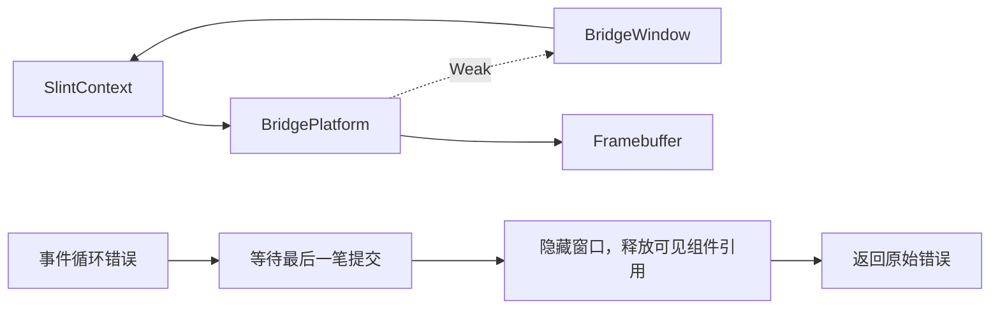

# NX5 TDE 退出清理修复：2026-10-11

正常退出和输入 EIO 退出时，三块 TDE MMZ 缓冲不再依赖内核强制回收。问题来自平台与窗口的强引用环，以及错误返回时未隐藏窗口；原生 TDE 释放函数和厂商 SDK 无需修改。

本轮在 `a941a7b` 基础上验证退出清理修复。被测显示程序 SHA256 为 `e5ebaa6d9ca40e2e712a6b8b0b391c4826ffc1b14e4fb1cd4b53083807190666`，源码文件摘要、构建与部署信息见 [部署清单](../evidence/nx5-tde-exit/2026-10-11/deployment-manifest.json)。原始证据保存在本地 `evidence/nx5-tde-exit/2026-10-11/`，不随 Git 分发；本文的证据链接和重放命令需要该档案。[上一轮报告](nx5-regression.md) 保留 `2cd98fa` 的失败结果。

## 根因与修复

`BridgePlatform` 原先强持有 `BridgeWindow`，而 Slint 窗口会保存所属 `SlintContext`，上下文又拥有平台。应用离开作用域及 UI 线程退出时，这个引用环使 `Framebuffer::drop()` 和 TDE 原生析构都无法到达。

另一个环只在异常路径保留：当前 Slint 生成的 `ComponentHandle::run()` 在事件循环错误返回时跳过 `hide()`；可见窗口对组件的强引用因此仍然存在。只修复平台对窗口的引用后，正常退出回归通过，EIO 回归仍失败。

修复集中在 [runtime.rs](../src/runtime.rs)：创建根窗口时保存弱引用，运行循环期间临时升级；等待最后一笔提交完成后，在错误返回路径隐藏根窗口并保留原始错误。同一组件正常退出后再次运行的既有回归仍通过。公开 `init(Config)` 接口、双页提交契约和 `Framebuffer` 的析构顺序保持原有行为。



引用环消除后，应用释放组件、定时器及观察线程，UI 线程退出便可销毁平台：等待提交线程结束 → 释放 TDE target 与两个 source → 释放 SDK 会话 → 解除 framebuffer 映射并关闭文件。WBC 观察线程仍由应用等待完成，不在事件循环错误返回时提前关闭它共用的 SDK。

这是已完成作业的正常/EIO 清理修复。TDE 作业完成状态未知时，原生实现有意保留资源以避免 DMA 访问已释放内存；该安全策略及故障注入判据没有改动。测试中 SDK 关闭 VO 时仍会打印 `Force to close voDev(0)`；本轮确认消除的是三块 TDE 的 `MMB LEAK`/强制解除映射，不把两类日志混同。

## 主机回归

[完整安装平台后的析构回归](../src/tests/framebuffer_lifecycle.rs) 使用真实 Slint 组件、事件循环和线程退出，配合内存 framebuffer、TDE 资源替身及 SDK 释放记录。退出触发等待首次提交；EIO 来自关闭 PTY 从端后的真实 `read()` 系统调用。断言检查 TDE → SDK 顺序、释放时映射/文件仍有效，以及线程退出后映射消失。

| 版本 | 正常退出 | EIO 退出 |
| --- | --- | --- |
| 原实现 | 失败：TDE/SDK 均未析构 | 失败：TDE/SDK 均未析构 |
| 仅弱化平台窗口引用 | 通过 | 失败 |
| 完整修复 | 通过 | 通过 |

最终回归再次对原实现运行并正确失败，随后恢复修复代码并通过。记录见 [原实现失败](../evidence/nx5-tde-exit/2026-10-11/host-final-tests-old-runtime.log)、[单步定位](../evidence/nx5-tde-exit/2026-10-11/host-weak-only.log)、[修复后通过](../evidence/nx5-tde-exit/2026-10-11/host-green.log)。

三个 feature 的 workspace 矩阵、未选/冲突 feature 拒绝检查、格式、严格 Clippy 均通过。启用 MCP 的 `nx5-tde` 检查为 30 个库内测试、3 个观察器测试和 2 个公共接口测试通过；三个 ignored 硬件测试另在设备运行。原生 C 的五种故障注入在 ASan/UBSan 下通过，包含未知完成状态的保留策略。ARM 显示程序和测试程序均成功构建。

## 实机结果

设备仍为 USB1 / `192.168.1.151:5555`，Linux 4.9.138 #233，启动 ID `938c34d4-456a-4b1a-b532-678c0f92efd0`。三项固件摘要与准入一致，没有重启或修改驱动。旧常驻进程经 MCP 暂停并确认提交线程空闲后停止；该次 SIGTERM 不计入退出清理回归。旧程序已备份并核对摘要。

| 用例 | 结果 |
| --- | --- |
| 正常退出，两轮 | PID 2158、2411；各 300 个 WBC 样本，黑白各 150、混色 0；退出码 0 |
| WBC 活跃时 EIO，两轮 | PID 2202、2453；各 600 个样本、混色 0；EIO 后分别继续采集 565、567 帧，约 19.65、19.74 秒后完成 WBC 清理，再返回退出码 1 |
| 60 秒纹理运行 | PID 2314；11 个统计窗口，首窗 28.43 FPS、其后均 29.00 FPS；TDE 错误 0 |
| TDE 像素与回退 | `nx5_hardware_compare` 通过，含 80 帧增量重绘和故障回退；透明混合最大通道差 1/255 |
| 演示双页像素 | `nx5_demo_pages_match_full_frames` 通过，100 帧交替页，最大通道差 1/255、超容差通道 0 |
| 阻塞翻页 | `blocking_flip_cadence` 通过；128 次提交排除 8 次预热，120 次均值 34.479575 ms，即 29.003 FPS |

五个完整显示进程用例都在运行中确认了一个 target、两个 source，共 7200 KiB；退出后 MMZ 均回到 4900 KiB / 2 块，VO/WBC 均关闭，连续内核记录中没有对应 PID 的 MMZ 泄漏回收。三项硬件测试分别运行，结束后同样无 MMZ 残留或泄漏回收。详见 [结构化结果](../evidence/nx5-tde-exit/2026-10-11/results.json) 与 [设备原始记录](../evidence/nx5-tde-exit/2026-10-11/device/)。

最终快照时间为 **2026-10-11 16:12:55（北京时间）**。常驻修复版 PID **2558**，路径 `/run/slint-bridge-mcp/display-mcp`，参数 `--textures --touch=/dev/input/event0`；关闭故障注入及持续性能日志。MCP 的 6/18 个工具检查通过：1024×600 窗口，暂停帧号 1988 保持不变，恢复后递增；[截图](../evidence/nx5-tde-exit/2026-10-11/final-screen.png) 已查看，文字和纹理正常。当前 MMZ 12100 KiB / 5 块为运行中的必要分配，WBC 未运行。见 [最终设备快照](../evidence/nx5-tde-exit/2026-10-11/device/final-device.txt)。

WBC 是有限合成输出采样，双页像素测试使用真实 TDE 和生产写页代码、内存文件承载两页；这些结果不能扩大为所有物理 LCD 帧的无撕裂认证。MCP 截图重新软件渲染，也不作为硬件扫描输出证明。

## 复现与判据

主机上从仓库根执行：

```sh
cargo test --locked --offline --features nx5-tde installed_platform_releases_resources -- --nocapture
```

构建、固件核对与独占设备要求见 [NX5 设备说明](../test-app/devices/nx5/README.md)。正常/WBC EIO 用例继续使用 [run-regression.sh](../test-app/tools/nx5/display/run-regression.sh) 和一次性 [read EIO 注入库](../test-app/tools/nx5/display/inject-read-error.c)，注入库构建方法见 [上一轮方法](nx5-regression.md#wbc-异常退出方法)。先部署显示程序、观察器插件、runner 和注入库，创建全新的可写输出目录；确认没有另一个显示所有者，再运行：

```sh
# 设备 root 会话；每个输出目录仅执行一轮，避免覆盖证据或复用触发文件。
sh /run/slint-bridge-tde-exit/run-regression.sh \
  /run/slint-bridge-mcp/display-mcp /run/slint-bridge-tde-exit pattern
sh /run/slint-bridge-tde-exit/run-regression.sh \
  /run/slint-bridge-mcp/display-mcp /run/slint-bridge-tde-exit fault
# fault 预期返回 1，必须结合日志判定。
```

取回证据后检查完整退出和正常 WBC 输出：

```sh
python3 test-app/tools/nx5/display/check-exit.py evidence/nx5-tde-exit/2026-10-11/device/pattern
python3 test-app/tools/nx5/display/check-exit.py evidence/nx5-tde-exit/2026-10-11/device/fault
python3 test-app/tools/nx5/display/check-run.py evidence/nx5-tde-exit/2026-10-11/device/pattern.log --wbc
```

退出检查要求 TDE 确实初始化且三块分配曾存在，初始/最终 MMZ 干净，内核前后记录有重叠且该 PID 无 `MMB LEAK`；EIO 还要求真实注入、注入后继续采样、观察器完成先于应用报错。它正确拒绝了七种破坏后的证据，包括泄漏、缺少活动分配、日志断档、错误退出码、缺少 EIO、错误清理顺序及残留 MMZ。不能仅用应用退出码或最终 MMZ 数量证明主动释放。
