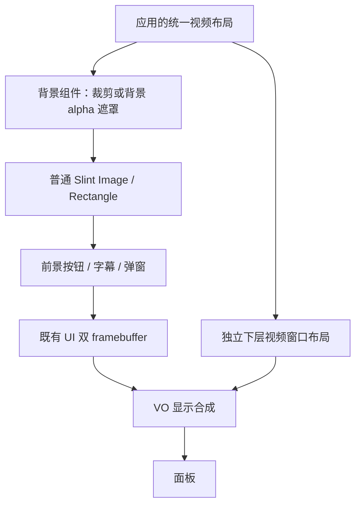

# NX5 图片背景与多个视频透明区域

2026-10-15。范围：NX5、一个 Slint 界面内多个视频区域；视频帧在 UI 下方的独立视频层。结合官方 Slint 1.18.1 文档、本地源码与主机像素试验后，**当前图片背景需求优先使用公开组件和 Image，不需要先增加 compiler/core 原生元素**。本轮没有更改运行库、Slint 源码或设备状态。

## 推荐方案与分层

将背景从前景 UI 中明确分离。应用统一维护视频区域矩形，供背景透明处理与 NX5 视频窗口布局共同使用；边框、按钮、字幕和弹窗仍正常绘制。保留一个全屏 Slint 根窗口和既有双 framebuffer。

| 候选 | 实现位置 | 优点与限制 |
| --- | --- | --- |
| **屏幕尺寸背景 + 洞外矩形裁剪** | 应用 Rust 计算矩形差集；普通 `.slint` 组件组合 `Rectangle { clip: true }` 与 `Image` | 不修改 Slint；移动时主要更新几何，不重建整张透明位图。须先把背景统一为屏幕像素尺寸，片段保持同一源图坐标；实际 TDE 调用数和小片段成本仍需测量 |
| **背景 RGBA 遮罩 + 单个 Image** | 应用 Rust 使用 `SharedPixelBuffer`，普通 `.slint Image` 显示 | 多洞和任意背景缩放容易控制；只处理背景，上层控件不受影响。需要额外缓冲、更新时可能复制，当前 NX5 TDE 也可能因透明目标而软件回退 |
| 自定义 Clear 原生元素 | Slint compiler/core/renderer | 仅在必须对任意已有 UI 树执行“擦掉之前所有内容、保留后续内容”且背景不能分离时再考虑。不是当前图片背景需求的首选 |

官方自定义控件支持组合现有元素、属性、回调；Rectangle 提供子项矩形裁剪。CPU 自定义绘图的官方示例是把内容画入 `SharedPixelBuffer`，再通过 `Image` 显示。这里的内容仅是背景，不包含视频帧。[Custom Controls](https://docs.slint.dev/latest/docs/slint/guide/development/custom-controls/)、[Rectangle.clip](https://docs.slint.dev/latest/docs/slint/reference/elements/rectangle/#clip)、[Image CPU 绘图](https://docs.slint.dev/latest/docs/rust/slint/struct.Image)

职责如下：

- **应用/UI 模块**：封装普通 `BackgroundWithHoles` / `VideoArea` 组件，维护同一份区域数据；控制可见性、裁剪和前景层级。
- **应用 Rust 背景处理**：背景加载或屏幕尺寸改变时准备目标尺寸图片；按洞列表计算可见矩形，或生成带 alpha=0 洞的背景缓冲。背景与布局不变时直接复用，视频每帧更新不应触发背景重建。
- **Slint renderer**：沿用公开 Image/Rectangle 的正常绘制和局部重绘，无须新增 Item。
- **slint_bridge/NX5**：继续保留 alpha、处理双页提交，并由视频模块同步下层矩形；不在最终 framebuffer 上统一挖孔。

前提是开口下面没有其他不透明 UI 填充。存在不透明父容器或额外背景时，它们也必须避开开口；本方案不是能穿透任意既有 UI 树的橡皮擦。

## 图片分片与背景遮罩的细节

分片法计算“屏幕矩形减去所有视频矩形的并集”，产生若干不相交可见矩形。各矩形只裁剪同一张背景图，背景图片在所有片段中保持相同的全屏位置和尺寸，不能把完整图片分别 fit 到每个片段。布局变化只更新矩形模型，源图仍复用。

**当前软件路径存在一个已经复现的限制：直接对非整数 `cover` 缩放的背景分片，不能保证与单个全图 Image 逐像素相同。** 因此需要先把背景准备为目标像素尺寸，再做 1:1 裁剪。具体离屏试验见下一节；这不是对官方所有后端的普遍结论，也未在本轮修复该采样问题。

背景遮罩法保留一份没有洞的基准背景，生成只带背景内容和透明洞的 RGBA 图片。洞移动时恢复旧区域、清除新区域，再正常绘制前景控件。`SharedPixelBuffer` 是引用计数容器，共享时修改可能触发整张复制，不能承诺永久零拷贝。[SharedPixelBuffer 的复制行为](https://docs.slint.dev/latest/docs/rust/slint/struct.SharedPixelBuffer#method.make_mut_slice)

一张 1024×600 RGBA 缓冲为 2,457,600 字节，约 2.34 MiB；基准图、输出图和临时复制可能同时存在。这是普通内存成本，不是新增物理 framebuffer。高频拖动时还要计入重建、上传和绘制成本。

NX5 当前 TDE 对带透明源的混合要求目标区域不透明，透明目标走精确软件合成。因此整张带洞背景可能改变硬件加速命中，不能只凭减少 Image 数量就判定它最快；应与不透明分片方案实测比较。[现有 TDE 条件](../src/backends/nx5/tde/native.c:427)

## 本地主机像素试验

使用当前本地 Slint 1.18.1（`fa6a6d0`）、公开 API、`MinimalSoftwareWindow` 和 `ReusedBuffer`，离屏 128×96。两种确定性背景各执行 9 个连续状态：无洞、单洞、双洞、移动/缩放、洞重叠、越界裁剪、全屏洞、隐藏后恢复、重新显示。额外叠加不透明控件、半透明控件和可切换的模态矩形；以完整背景参考和独立逐像素合成计算预期。

| 试验 | 结果 |
| --- | --- |
| 128×96 背景按 1:1 映射 + 普通 Rectangle.clip 分片 | 18 个状态、221,184 像素全部精确一致；旧洞恢复、透明区域和上方控件均符合预期 |
| 目标分辨率 SharedPixelBuffer 背景遮罩 + 单个 Image | 同样 18 个状态、221,184 像素精确一致 |
| 97×53 图片直接 `cover` 到 128×96 后分片 | 对照失败；第一个单洞状态，洞外 (119,9) 的 RGB 为 (90,102,22)，全图参考为 (127,161,105)，与测试图的一源像素步进一致 |

第二种试验先取得同尺寸的全图背景参考，再在独立背景缓冲上清洞；它验证透明组件与保留缓冲语义，未替生产背景缩放器或缓存策略做性能验收。第一种试验说明 1:1 分片候选可行，不能据此承诺任意缩放都无接缝。

原始探针源码和输出保存在本地忽略目录 `evidence/slint-video-options/2026-10-15/`，另行获取后可复现；三份源码分别为 `background-probe.rs`（1:1）、`background-masked-probe.rs`、`background-cover-probe.rs`（保留的失败对照）。本轮未测试 NX5 TDE 实机性能、真实视频层或面板扫描输出。

## LGUI3 的 vdec 与 Slint 普通透明组件为何不同

LGUI3 `476e327e` 的 vdec 只定义宽高，位置/隐藏沿用通用控件；该组件不创建解码通道。它把控件移至兄弟控件底部，使用 `LV_OPA_COVER` 和 `0x00000000`，关闭圆角和边框。[属性与位置](/home/dpower/data/GitLab/LGUI3/c_library/src/lgui/lgui_ctrl/lgui_ctrl_vdec.c:44)、[创建设置](/home/dpower/data/GitLab/LGUI3/c_library/src/lgui/lgui_ctrl/lgui_ctrl_vdec.c:64)

无遮罩、覆盖填充分支直接把含 alpha 的整像素写入目标，因此可以清掉之前的图片背景；存在 vdec 时还跳过部分 GPU 路径。[填充](/home/dpower/data/GitLab/LGUI3/c_library/src/lvgl/lv_draw/lv_draw_blend.c:359)、[像素赋值](/home/dpower/data/GitLab/LGUI3/c_library/src/lvgl/lv_misc/lv_color.c:40)

Slint 普通 source-over 在源 alpha=0 时保留目标像素。叠一块透明 Rectangle 或设置 opacity=0 都不会擦除已绘制的照片；当前 Showcase 的 cutout 实际是隐藏整张 wallpaper。[混合公式](/home/dpower/data/GitHub/slint-1.18.1/internal/renderers/software/draw_functions.rs:874)、[当前 wallpaper](../test-app/ui/showcase.slint:77)

不能在最终写页时把视频矩形统一清零，因为背景和按钮/弹窗已经混在一起。仅改 alpha 而保留 RGB 也违反预乘约束。公开背景方案通过“背景自身带洞/不画洞内内容”实现所需效果，而不要求复刻 LGUI3 覆盖擦除任意 UI 的全部语义。

## 官方自定义绘制接口核对

本次 `latest` Rust 文档显示 1.18.1；链接可能随官方更新，实现边界同时核对固定 `v1.18.1` 源码。

| 接口 | 当前适用性 |
| --- | --- |
| 普通 `.slint` 自定义组件 | 官方支持组合现有元素、属性与回调；适合背景/视频区域组件。[Custom Controls](https://docs.slint.dev/latest/docs/slint/guide/development/custom-controls/) |
| CPU 自定义绘图 | 官方 Image 文档给出 SharedPixelBuffer/tiny-skia 示例；可在应用中生成背景图。[Image](https://docs.slint.dev/latest/docs/rust/slint/struct.Image) |
| 原生 Canvas / Item paint 回调 | 未找到 1.18.1 已发布的通用公开接口；官方 [#13495](https://github.com/slint-ui/slint/issues/13495) 本次查询仍为 Open 提案，不是已发布能力 |
| 自定义整个 renderer | 公开 `Renderer` 是 sealed；普通应用应使用已有 renderer，内部实现扩展会增加维护范围。[Renderer](https://docs.slint.dev/latest/docs/rust/slint/platform/trait.Renderer) |
| `set_rendering_notifier` | 窗口级前/后通知，软件 renderer 未覆盖默认 Unsupported；也不是背景与前景之间的 Item 回调。[Window](https://docs.slint.dev/latest/docs/rust/slint/struct.Window#method.set_rendering_notifier)、[固定版本默认实现](https://raw.githubusercontent.com/slint-ui/slint/v1.18.1/internal/core/renderer.rs) |
| `TargetPixelBuffer` | `experimental` 渲染目标/加速接口；普通透明矩形仍可能被跳过，接口没有提供业务 Item 身份或通用 Canvas 注册。[1.18.1 接口](https://raw.githubusercontent.com/slint-ui/slint/v1.18.1/internal/renderers/software/target_pixel_buffer.rs) |
| Path / evenodd | `fill-rule` 描述 Path 自身填充；`Path.clip` 是 view-box 边界裁剪，不是按 Path 形状反向裁剪图片。透明路径也不能清掉此前背景。[Path](https://docs.slint.dev/latest/docs/slint/reference/elements/path/) |

官方软件 renderer 的 Path 实现还存在 fill-rule 传递边界，未在本轮验证 evenodd 像素；因此不把复杂 Path 遮罩列为当前方案依赖。OpenGL texture/underlay 示例依赖对应图形 API，不等同 NX5 当前软件 renderer + TDE 环境。[固定版本软件实现](https://raw.githubusercontent.com/slint-ui/slint/v1.18.1/internal/renderers/software/lib.rs)、[官方 renderer 范围](https://docs.slint.dev/latest/docs/slint/guide/backends-and-renderers/backends_and_renderers/)

## 何时才需要 Slint 内部扩展

若后续要求一个控件能放在任意既有 UI 树中，把其之前绘制的所有背景/容器擦穿，同时保留之后的控件，而且无法分离背景，那才需要专用 Clear 原语。届时涉及 compiler/core Item 定义、软件 renderer、裁剪/脏区/缓存与相关后端行为；它不是只加一份 `.slint` 文件，也没有必要替换整个 Slint 架构。

当前图片背景场景已有公开 API 候选，建议先完成 NX5 上的 1:1 分片与背景遮罩性能对照，再决定最终实现，不以原生 Item 扩展作为前置条件。视频布局与 UI PAN 仍不是已确认的同一原子事务；先显示过渡遮罩并确认 UI 提交、更新并确认视频状态、再揭开，属于后续需验证的切换策略。

## 下层多视频的实现依据与限制

外部 P-URU-A0 `c17dd218` 已有“一个下层视频输出内四个区域”的调用链：区域 1–4 映射到 0–3 号窗口，默认四分屏，能把选中区域放大再恢复。这是可借鉴的源码，不是当前板的四路实时容量保证。[区域分配](/home/dpower/data/GitLab/P-URU-A0/func_library/src/media/video_decoder.c:56)、[窗口设置](/home/dpower/data/GitLab/P-URU-A0/func_library/src/media/video_decoder.c:230)、[放大恢复](/home/dpower/data/GitLab/P-URU-A0/func_library/src/media/video_decoder.c:656)

不可机械移植其逐路停止流程：参考代码在 `Video_Decoder_Stop` 中调用全局 `VDEC_DeInit`，而头文件说明该操作会销毁所有通道。新模块需要独立的逐路停止与最后一个使用者释放逻辑，不能停止一路时关闭其他视频或 UI。[参考停止流程](/home/dpower/data/GitLab/P-URU-A0/func_library/src/media/video_decoder.c:373)

下面保留 SDK 的细项核对，供后续实现选择底层接口。

### 1. 结论与证据边界

接口模型支持“视频层内多个窗口 + 上方透明 UI”的方案；但现有封装存在空操作、重建窗口及层间生命周期耦合，不能直接把若干 `VO_EnableVideoLayer` 调用包装成任意布局的安全控件。底层 MPI 提供按窗口配置位置、裁剪及按层开始/结束属性更新的入口，适合作为后续板级实现的候选；实时路数、窗口重叠、缩放范围和与 UI 翻页同步仍需针对目标固件验证。[窗口与事务接口](/home/dpower/data/GitLab/LGUI3/c_library/third_party/include/NX5/codec/mpi_vo.h:40)、[图形层 alpha](/home/dpower/data/GitLab/LGUI3/c_library/third_party/include/NX5/codec/mpi_vo.h:122)

外部 LGUI3 仓库为干净的 `476e327ebec2886b2b10e7bb93647f4adf814d25`。本节源码链接均指当前本地文件；其他机器需取得对应仓库。未找到可读的厂商 VO/VPPU/VDEC 实现源码，因此实现级结论来自以下特定 ELF 的静态反汇编，B 的 SHA256 与本项目最近 NX5 设备快照记录相同；本轮没有重新查询设备或执行这些视频接口。[最近设备记录](../test-app/devices/nx5/current-target.json)

| 标记 | 本地二进制 | SHA256 |
| --- | --- | --- |
| A | [codec/libVideoDec.so](/home/dpower/data/GitLab/LGUI3/c_library/third_party/lib/NX5/codec/libVideoDec.so) | `8064b9d16c7c88b6b6d40c66e40b754e392c36ab03803cb1f04c6ed0a331bd82` |
| B | [codec_rorate/libVideoDec-1.6.6.so](/home/dpower/data/GitLab/LGUI3/c_library/third_party/lib/NX5/codec_rorate/libVideoDec-1.6.6.so) | `cb50026662c2c59955c775a96f567333e62a8dbc2f60fb21a01c0b5d11385092` |

下文 `B@地址` 指 B 的 ELF 虚拟地址。复查可使用 `/opt/X5/gcc-linaro-5.3.1-2016.05-x86_64_arm-linux-gnueabi/bin/arm-linux-gnueabi-objdump -d --start-address=0x起点 --stop-address=0x终点 <二进制路径>`，不执行二进制。找到的 [NX5_SPEC.pdf](/home/dpower/data/GitHub/sop-company/departments/cto/knowledge/sources/NX5_SPEC.pdf) 实际是 Git LFS 指针，未取得 PDF 实体，不能引用为芯片规格。

### 2. 三种编号不能混用

| 对象 | 接口含义 | 核对结果 |
| --- | --- | --- |
| 解码通道 | `VDEC_CreateChn` 返回的通道号 | 每一路码流有独立属性、缓冲、收流与取帧接口；创建失败是 `-1`，不是 0。[创建](/home/dpower/data/GitLab/LGUI3/c_library/third_party/include/NX5/codec/VDecApi.h:198)、[收流/送流](/home/dpower/data/GitLab/LGUI3/c_library/third_party/include/NX5/codec/VDecApi.h:229) |
| 高层 `Channel` | `VO_EnableVideoLayer(Channel, Layer, Info)` 的第一参数 | B 将它传给 `FY_MPI_VO_SetVideoLayerAttr`、`EnableVideoLayer` 的 `VoLayer` 参数，即底层视频层。B@`0x88cc–0x88dc`、`0x8944–0x8946`。 |
| 高层 `Layer` | 同一调用的第二参数 | B 将它传给 `FY_MPI_VO_SetChnAttr`、`EnableChn` 的 `VoChn` 参数，即该视频层内的显示窗口。B@`0x89d2–0x89f2`、`0x8a58–0x8a5c`；[MPI 声明](/home/dpower/data/GitLab/LGUI3/c_library/third_party/include/NX5/codec/mpi_vo.h:52)。 |

因此一个 Slint 视频区域应最终映射到一个 `(VoLayer, VoChn)` 显示窗口；不应按封装参数名称误认为每个区域都独占一张物理视频层。这是接口和静态实现支持的映射方案，尚不是本仓库已实现的公开 API。

### 3. 解码帧到显示窗口

高层提供 `VDEC_SendStream → VDEC_StartRecvStream → VDEC_GetImage → VO_ChnShow → VDEC_ReleaseImage` 这些操作。`StartRecvStream` 的注释明确为解码一帧，不能只凭名称假定它启动永久后台解码线程；`GetImage/ReleaseImage` 必须串行成对，禁止连续借出两帧再依次释放。[解码/取帧契约](/home/dpower/data/GitLab/LGUI3/c_library/third_party/include/NX5/codec/VDecApi.h:229)、[释放约束](/home/dpower/data/GitLab/LGUI3/c_library/third_party/include/NX5/codec/VDecApi.h:295)

B 的 `VO_EnableVideoLayer` 创建 VPPU 通道、设输出模式与旋转，再调用 `FY_MPI_SYS_Bind`，源为 `FY_ID_VPPU`，目的为 `FY_ID_VOU`，目的编号正是传入的层/窗口；`VO_ChnShow` 则把帧送到该 VPPU 通道。证据：B@`0x8ac6–0x8b0a`、`0x8f5a–0x8f88`；[模块编号/绑定结构](/home/dpower/data/GitLab/LGUI3/c_library/third_party/include/NX5/codec/include/fy_common.h:189)、[绑定 API](/home/dpower/data/GitLab/LGUI3/c_library/third_party/include/NX5/codec/mpi_sys.h:20)。

这证明现有封装走“应用取得解码帧 → VPPU → VO 窗口”，不能把它描述为已存在的 VDEC→VO 自动直绑。若改为直接 MPI 绑定，需要另外确认允许的源/目的组合与缓冲所有权；`FY_MPI_SYS_Bind` 的声明本身不能证明任意组合有效。

帧退休仍有证据缺口：B 的 `VO_ChnShow` 以 `bPlayMode=1`、`u32TimeOut=30` 调用 `FY_MPI_VPPU_SendFrame`；后者复制 144 字节帧描述符到 ioctl 参数，再发 `0x40a04a09`（B@`0x8f64–0x8f88`、`0x15604–0x15626`）。这不是像素复制证据，也不能判断驱动是在返回前完成读取还是内部 retain。`VO_ChnShow` 成功后某些旋转分支会释放临时 MMZ（B@`0x8f90–0x8fb4`），但不能将封装行为升级为对原始解码帧的完成契约；特别是发送超时/失败后的释放条件仍需驱动文档或针对性验证。头文件没有注明此 timeout 的时间单位。[SendFrame 声明](/home/dpower/data/GitLab/LGUI3/c_library/third_party/include/NX5/codec/mpi_vppu.h:38)

解码头文件列有 H.264/MJPEG/H.265 及 YV12/NV21 输出格式；这是 API 枚举，不是已确认的目标分辨率、profile、码率或并行性能。[格式定义](/home/dpower/data/GitLab/LGUI3/c_library/third_party/include/NX5/codec/VDecApi.h:22)

### 4. 最大路数：三个不同口径

| 证据 | 所见上限或限制 | 可以得出的结论 |
| --- | --- | --- |
| 底层头文件 | VDEC 16；VPPU 16 通道、3 路径；VO 2 设备、3 视频层、每层通道编号上限常量 16、4 图形层 | 这些是编程模型常量，不能相乘得到可同时播放的视频路数。[fy_defines.h](/home/dpower/data/GitLab/LGUI3/c_library/third_party/include/NX5/codec/include/fy_defines.h:89) |
| 高层头文件 | `Channel=0/1`，每个通道 `Layer=0..3`；启停通道隐含第 0 层 | 文档描述 2×4 的编号范围，并且不是相互独立的生命周期。[VoApi.h](/home/dpower/data/GitLab/LGUI3/c_library/third_party/include/NX5/codec/VoApi.h:112) |
| A、B 高层解码分配器 | `VDEC_CreateChn` 只扫描 8 个槽位，全部占用则返回 -1 | 特定封装实现最多提供 8 个解码句柄槽；仍不能承诺 8 路实时解码。A@`0x6c9c–0x6cde`，B@`0x74e6–0x7528`。 |
| B 输出入口 | 高层先拒绝 `Channel>3`/`Layer>3`，但底层 `SetChnAttr` 又拒绝 `VoLayer>2`/`VoChn>15` | 头文件、封装过滤和 MPI 范围不一致，不能据此宣称 4×4 可用。B@`0x8898–0x88a6`、`0xcd30–0xcd3a`。 |

实际容量还受解码格式、分辨率、帧率、VPPU/VO 资源、MMZ/缓冲和 UI/TDE 竞争约束。本轮没有性能规格实体或多路实测结果，不能给出可靠的产品最大路数。首轮验证可选两个互不重叠窗口，再按目标码流逐级增加；“两个”是验证起点，并非已验证容量。

### 5. 位置、缩放、裁剪与更新事务

`VO_LAYER_RECT` 给出有符号 X/Y 与无符号 W/H；MPI 窗口属性含 `stRect` 和 `u32Priority`，视频层属性又区分显示矩形 `stDispRect` 与画布尺寸 `stImageSize`。[高层矩形](/home/dpower/data/GitLab/LGUI3/c_library/third_party/include/NX5/codec/VoApi.h:36)、[窗口属性](/home/dpower/data/GitLab/LGUI3/c_library/third_party/include/NX5/codec/include/fy_comm_vo.h:145)、[层属性](/home/dpower/data/GitLab/LGUI3/c_library/third_party/include/NX5/codec/include/fy_comm_vo.h:281)

B 初始化视频层时将其显示尺寸、画布尺寸都设为内部屏幕尺寸，并把 `Info.Rect` 原样写入窗口 `stRect`（B@`0x88bc–0x88dc`、`0x89c8–0x89f2`）。因此采用全屏 1:1 视频层是让 Slint 逻辑矩形经缩放换算到屏幕像素的最简候选；若视频层自身有缩放或位移，必须再做坐标变换。负坐标、越界、最小矩形、奇数坐标与缩放倍率的真实约束未在这些声明中给出，需验证。

| 操作 | 可靠证据与限制 |
| --- | --- |
| 改变目标矩形 | `VO_Resize` 有正式声明；但 A/B 实际先 `DisableVideoLayer`，清零属性后只写新 Rect，再 `EnableVideoLayer`，不检查两次返回值便返回 1。旋转等原属性不会被保留。A@`0x8750–0x8772`，B@`0x90e0–0x9102`；[接口](/home/dpower/data/GitLab/LGUI3/c_library/third_party/include/NX5/codec/VoApi.h:209)。不能承诺无闪烁、失败可回滚或同层其他窗口不受影响。 |
| 高层 Set/Get 属性 | 头文件已标注空函数；A@`0x8604/0x8608`、B@`0x8efc/0x8f00` 均直接返回 1。[头文件说明](/home/dpower/data/GitLab/LGUI3/c_library/third_party/include/NX5/codec/VoApi.h:161) |
| 高层裁剪/缩放 | `VO_SetZoomInWindow` 虽有声明，但 A@`0x860c`、B@`0x8f04` 也只是返回 1；不能据此实现 cover 裁剪。[声明](/home/dpower/data/GitLab/LGUI3/c_library/third_party/include/NX5/codec/VoApi.h:185) |
| MPI 缩放/裁剪 | VPPU 输出模式有目标 W/H，裁剪有比例/绝对坐标；VO 有按矩形或比例的 Zoom。接口存在，具体组合、对齐和生效时刻未验证。[VPPU 结构](/home/dpower/data/GitLab/LGUI3/c_library/third_party/include/NX5/codec/include/fy_comm_vppu.h:22)、[VPPU API](/home/dpower/data/GitLab/LGUI3/c_library/third_party/include/NX5/codec/mpi_vppu.h:22)、[VO Zoom](/home/dpower/data/GitLab/LGUI3/c_library/third_party/include/NX5/codec/include/fy_comm_vo.h:313) |
| 开始/结束更新 | `FY_MPI_VO_SetAttrBegin/End(VoLayer)` 存在；B 分别发 `0x4f2c`/`0x4f2d` ioctl 并返回结果（B@`0xc778–0xc870`）。这是按视频层的入口，不能证明与 UI framebuffer 的 PAN 同一帧原子生效，也没有提交 token、回滚或扫描完成证明。[声明](/home/dpower/data/GitLab/LGUI3/c_library/third_party/include/NX5/codec/mpi_vo.h:43) |

窗口移除也有耦合：头文件指出第 0 窗口关闭后其他窗口可能无法显示；B 的 `VO_DisableVideoLayer(Channel, 0)` 在解绑/销毁 VPPU、关闭窗口后直接关闭整个 MPI 视频层（B@`0x8cee–0x8d4c`）。后续资源管理不能把每个封装窗口当作完全独立的对象随意销毁。[原始约束](/home/dpower/data/GitLab/LGUI3/c_library/third_party/include/NX5/codec/VoApi.h:124)

### 6. 下层视频与上层透明 UI

MPI 区分视频层和图形层；视频层有优先级入口，图形层有逐像素/global alpha，窗口也有 `u32Priority`。这支持分层设计，但现有声明没有明确图形层和视频层的所有全局顺序、优先级数值方向或每种分区模式下的窗口重叠规则。[层优先级](/home/dpower/data/GitLab/LGUI3/c_library/third_party/include/NX5/codec/mpi_vo.h:34)、[alpha 结构](/home/dpower/data/GitLab/LGUI3/c_library/third_party/include/NX5/codec/include/fy_common.h:127)

`VO_PART_MODE_SINGLE` 的注释是软件把多画面组成一个硬件单元，`MULTI` 则是每个分区一个硬件单元；同时错误码存在 `CHN_AREA_OVERLAP`。因此“有优先级字段”不等于任意视频窗口重叠都受支持，也不能假定多窗口均是互不影响的独立硬件平面。[分区模式](/home/dpower/data/GitLab/LGUI3/c_library/third_party/include/NX5/codec/include/fy_comm_vo.h:268)、[重叠错误](/home/dpower/data/GitLab/LGUI3/c_library/third_party/include/NX5/codec/include/fy_comm_vo.h:447)

建议首版仅承诺互不重叠的矩形视频区域；Slint 在对应位置输出透明像素，并在图形层绘制边框、文字和控件。该建议遵守视频在 UI 下层的范围，不要求视频帧进入 Slint 的图片/纹理路径。必须用真实视频 underlay 验证 UI 遮挡与 alpha；现有 [2026-10-12 alpha 报告](nx5-alpha.md) 明确当时没有接入视频解码器，不能当作多视频合成已通过。

### 7. 后续验证应回答的问题

1. 选定目标 SDK/固件后，确认可用 `(VoLayer, VoChn)`、视频在图形层下方、不同窗口的帧不会串路；明确窗口 0 的生命周期。
2. 两路目标码流同屏运行，逐路停止/恢复/销毁，检查另一窗口与 UI 是否继续正常；再测目标路数、内存和持续帧率。
3. 校验屏幕坐标、奇偶边界、尺寸/缩放限制、裁剪与 aspect ratio，再决定支持的 fit 模式和裁剪范围。
4. 测 `SetAttrBegin/End` 的批量布局时序、错误恢复及实际扫描变化；如果不能和 UI 翻页同步，采用有确认的过渡遮罩，避免暴露旧位置。
5. 所有视频 API 复用显示进程的 SDK 会话。验证退出顺序与在途帧释放，不以返回成功、固定延时或一次 VSYNC 替代已确认的缓冲所有权。

本节 SDK 结论仅包括主源阅读、外部仓库状态/ELF 指纹核对和静态反汇编；前文背景组件另有主机离屏像素试验。本轮没有修改 Slint/Bridge 运行代码，也没有对设备发起操作或验证真实视频 API。
