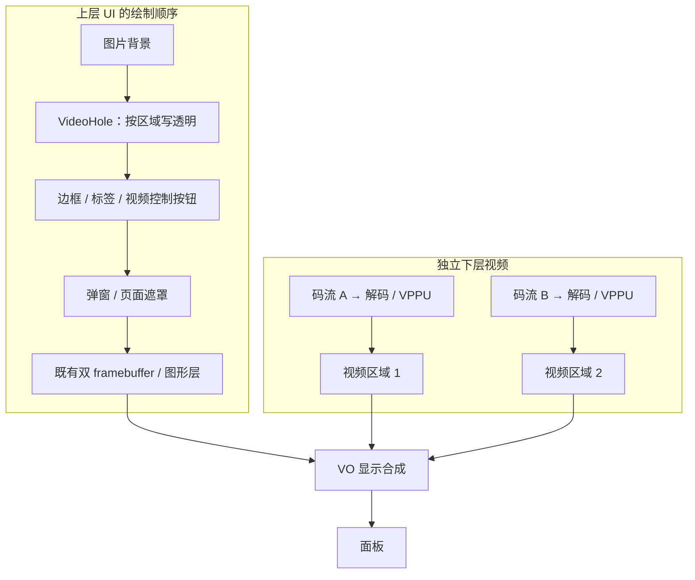

# NX5 图片背景与多个视频透明区域

2026-10-15。用户已明确：先处理 NX5；同一个 Slint 界面内有一个或多个视频区域，视频帧在 UI 下方的独立视频层。当前重点是图片背景如何留下透明区域，以及应在哪一层实现。本轮只做源码、接口与二进制静态分析，未修改运行代码或设备状态。

## 结论：透明开口属于 UI 场景，像素操作属于 renderer

保留一个全屏 Slint 根窗口和现有双 framebuffer。视频不进入 Slint 图片缓冲，解码/VPPU/VO 负责下层画面。上层 UI 的视频开口位置必须最终输出 RGBA 全零，其上方的文字、按钮、边框与弹窗仍按正常顺序绘制。

图片背景可采用两种方案：

| 方案 | 透明如何产生 | 处理位置 | 适用范围 |
| --- | --- | --- | --- |
| 背景排除视频区域 | 背景图只绘制屏幕减去视频区域的部分，开口处保持根画布透明 | 应用 `.slint` 的背景布局/裁剪，沿用现有 renderer | 视频布局受控，愿意让背景与视频区域共用布局数据；改动小 |
| 类似 LGUI3 的专用 `VideoHole` | 背景图先画，随后在控件的绘制顺序处用 Clear/Src 语义写零，再画上方控件 | UI 定义控件，Slint 软件 renderer 执行明确的清除操作；NX5 只实现其像素落地 | 需要把透明区域当作可复用组件，放在任意图片/容器背景上；最接近 `vdec` 语义 |

**若目标是复现 LGUI3 `vdec` 的“放置控件即开孔”，建议采用第二种。若只需当前固定页面的双分屏，第一种更简单。** 两种都不需要为每个视频创建一个 Slint 顶层窗口，也不需要增加物理 framebuffer。[当前单窗口约束](../src/runtime.rs:326)

图中的 `VideoHole` 是拟议控件，目前 Slint Bridge 没有此内建元素。图表示目标结构，不代表多路视频已在当前固件验收。

## LGUI3 的 vdec 实际做了什么

核对的 LGUI3 为 `476e327e`。`vdec` 属性只定义宽高，位置和隐藏状态沿用通用控件模型；它的代码没有创建解码通道或向 VO 送帧。[属性定义](/home/dpower/data/GitLab/LGUI3/c_library/include/lgui/lgui_ctrl/lgui_ctrl.h:1058)、[位置/大小/隐藏](/home/dpower/data/GitLab/LGUI3/c_library/src/lgui/lgui_ctrl/lgui_ctrl_vdec.c:44)

创建时把控件移到兄弟控件底部，设置 `bg_opa=LV_OPA_COVER`、颜色值 `0x00000000`，并关闭圆角和边框。这里的关键是“以覆盖路径写零色”，不是普通 source-over 的透明叠加。[vdec 绘制设置](/home/dpower/data/GitLab/LGUI3/c_library/src/lgui/lgui_ctrl/lgui_ctrl_vdec.c:64)

存在 vdec 控件时，LGUI3 的普通填充会跳过部分 GPU 路径；在无遮罩且覆盖不透明度的分支，调用 `lv_color_fill` 直接把包含 alpha 的整像素写入目标，因此零色能够清掉此前画出的背景。[填充路径](/home/dpower/data/GitLab/LGUI3/c_library/src/lvgl/lv_draw/lv_draw_blend.c:359)、[像素赋值](/home/dpower/data/GitLab/LGUI3/c_library/src/lvgl/lv_misc/lv_color.c:40)

全局 `vdec_index` 还影响其他 GPU 混合选择，这属于该实现的配套处理。迁移时应复用“明确清除 + 正确绘制顺序”的语义，不直接照搬“一有视频控件就全局停用 GPU”的策略。[GPU 混合条件](/home/dpower/data/GitLab/LGUI3/c_library/src/lvgl/lv_draw/lv_draw_blend.c:415)

现有 LGUI3 测试创建了两个 vdec，分别设置矩形并测试隐藏、缩小和移动；这证明 UI 控件模型支持多个开口，不是两路解码与输出性能的实测证据。[双区域测试](/home/dpower/data/GitLab/LGUI3/c_library/test/test_c_vdec.c:5)

## 为什么普通透明 Rectangle 不够

假设已经画出不透明背景图，再画一个 `background: transparent` 的 Rectangle。Slint 的正常 source-over 混合在源 alpha=0 时保留目标 RGB 和 alpha；背景图仍然是不透明的。`opacity: 0` 同样不等于擦除。[软件 renderer 的实际公式](/home/dpower/data/GitHub/slint-1.18.1/internal/renderers/software/draw_functions.rs:874)

当前 Showcase 根窗口虽然透明，通常仍绘制一张全屏 wallpaper；现有 cutout 模式是把整张 wallpaper 隐藏，所以不能直接等同于图片背景上的多个局部开口。[根透明设置](../test-app/ui/showcase.slint:20)、[wallpaper 条件](../test-app/ui/showcase.slint:77)

也不应在最终 `write_row` 或提交前，对所有视频矩形统一清零：这时背景、文字、按钮和弹窗已经合成在一起，清零会连上层控件一起擦掉。只改 alpha 而保留 RGB 还会破坏预乘像素约束；专用清除应把 RGBA 都置零。

## 建议的职责划分

- **应用/UI 场景层**：声明视频区域的 `id`、位置、尺寸、可见性和裁剪关系；决定哪些边框、按钮、弹窗位于区域上方。该组件只描述透明开口，不负责解码。
- **Slint renderer 层**：在该控件的绘制顺序处执行 Clear；服从实际脏区和祖先裁剪。移动/缩放/隐藏时同时失效旧、新区域，使旧位置恢复背景，新位置产生透明。清除参与原有保留画布和 TDE/CPU 顺序，不能越过未知 DMA 状态。
- **通用 framebuffer 层**：继续做既有 alpha 保留、格式转换、双页修复及完成等待，不增加视频矩形后处理，不改变两页复用约束。
- **NX5 视频模块**：把同一份布局数据映射到 `(VoLayer, VoChn)` 与物理屏幕坐标，管理源帧和窗口生命周期；复用当前 SDK 会话。硬件约束导致矩形调整时，UI 与视频必须使用同一个确认后的矩形。

若选择背景排除法，最直接的是把可绘制背景分成几个不相交矩形，各块裁剪同一张全屏定位的图片，保持源图坐标连续。不能让每块各自重新 `cover` 缩放，否则接缝处会显示不同位置的图像。无需每次移动都重解码 PNG 或生成一张带洞的新大位图。多个开口的重叠区域先求并集；背景、开口和前景控件分别维护绘制顺序。该方式会增加背景绘制片段数，需要测量开销，不能预设性能与一张全屏 Image 相同。

首版专用控件建议仅支持矩形、移动/缩放、隐藏和祖先矩形裁剪；圆角可以先由上方 UI 装饰遮挡。任意圆角清除、父级整体 opacity/offscreen 组合、旋转和重叠视频需要明确语义后再扩展，不能直接沿用普通 Rectangle 的混合假设。Clear 需要明确的绘制命令，不能伪装成 alpha=0 的普通矩形并被原有透明裁剪/混合路径跳过。

## 图片背景场景的验收重点

1. 一张不透明图片上放置一个、两个开口；确认开口内部 UI alpha=0，外部背景与原图逐像素一致。
2. 开口上方的文字、按钮、不透明和半透明弹窗保持可见；局部重绘、切换背景图或背景动画后，背景不能回填进未变化的开口。
3. 移动、缩放、隐藏、删除开口，验证旧位置背景恢复；交替两页不能残留旧洞，祖先裁剪外不能被清除。
4. 先以已知颜色的视频 underlay 检查位置、alpha 与遮挡，再接两路真实视频；MCP 只能检查上层 UI，最终合成用同进程 SDK/WBC 或面板观察验证。
5. UI PAN 与视频布局不是已证明的同一原子事务。布局切换可先显示覆盖旧/新区域的不透明过渡层并确认 UI 提交完成，再更新并确认视频状态，最后撤掉遮罩；视频状态未确认时保持遮罩，不以固定延时冒充完成。

以上是后续实施建议，本轮未编写 `VideoHole` 或改变任何实机显示。当前透明像素输出已有 NX5 0–128 alpha 契约，继续复用；先前黑色 VO 背景的 alpha 验证不能替代真实视频下层合成验证。[现有契约](software-platform.md#framebuffer-软件路径)

## 下层多视频的实现依据与限制

外部 P-URU-A0 `c17dd218` 已有“一个下层视频输出内四个区域”的调用链：区域 1–4 映射到 0–3 号窗口，默认四分屏，能把选中区域放大再恢复。这是可借鉴的源码，不是当前板的四路实时容量保证。[区域分配](/home/dpower/data/GitLab/P-URU-A0/func_library/src/media/video_decoder.c:56)、[窗口设置](/home/dpower/data/GitLab/P-URU-A0/func_library/src/media/video_decoder.c:230)、[放大恢复](/home/dpower/data/GitLab/P-URU-A0/func_library/src/media/video_decoder.c:656)

不可机械移植其逐路停止流程：参考代码在 `Video_Decoder_Stop` 中调用全局 `VDEC_DeInit`，而头文件说明该操作会销毁所有通道。新模块需要独立的逐路停止与最后一个使用者释放逻辑，不能停止一路时关闭其他视频或 UI。[参考停止流程](/home/dpower/data/GitLab/P-URU-A0/func_library/src/media/video_decoder.c:373)

下面保留 SDK 的细项核对，供后续实现选择底层接口。

### 1. 结论与证据边界

接口模型支持“视频层内多个窗口 + 上方透明 UI”的方案；但现有封装存在空操作、重建窗口及层间生命周期耦合，不能直接把若干 `VO_EnableVideoLayer` 调用包装成任意布局的安全控件。底层 MPI 提供按窗口配置位置、裁剪及按层开始/结束属性更新的入口，适合作为后续板级实现的候选；实时路数、窗口重叠、缩放范围和与 UI 翻页同步仍需针对目标固件验证。[窗口与事务接口](/home/dpower/data/GitLab/LGUI3/c_library/third_party/include/NX5/codec/mpi_vo.h:40)、[图形层 alpha](/home/dpower/data/GitLab/LGUI3/c_library/third_party/include/NX5/codec/mpi_vo.h:122)

外部 LGUI3 仓库为干净的 `476e327ebec2886b2b10e7bb93647f4adf814d25`。本节源码链接均指当前本地文件；其他机器需取得对应仓库。未找到可读的厂商 VO/VPPU/VDEC 实现源码，因此实现级结论来自以下特定 ELF 的静态反汇编，B 的 SHA256 与本项目最近 NX5 设备快照记录相同；本轮没有重新查询设备或执行这些视频接口。[最近设备记录](../test-app/devices/nx5/current-target.json)

| 标记 | 本地二进制 | SHA256 |
| --- | --- | --- |
| A | [codec/libVideoDec.so](/home/dpower/data/GitLab/LGUI3/c_library/third_party/lib/NX5/codec/libVideoDec.so) | `8064b9d16c7c88b6b6d40c66e40b754e392c36ab03803cb1f04c6ed0a331bd82` |
| B | [codec_rorate/libVideoDec-1.6.6.so](/home/dpower/data/GitLab/LGUI3/c_library/third_party/lib/NX5/codec_rorate/libVideoDec-1.6.6.so) | `cb50026662c2c59955c775a96f567333e62a8dbc2f60fb21a01c0b5d11385092` |

下文 `B@地址` 指 B 的 ELF 虚拟地址。复查可使用 `/opt/X5/gcc-linaro-5.3.1-2016.05-x86_64_arm-linux-gnueabi/bin/arm-linux-gnueabi-objdump -d --start-address=0x起点 --stop-address=0x终点 <二进制路径>`，不执行二进制。找到的 [NX5_SPEC.pdf](/home/dpower/data/GitHub/sop-company/departments/cto/knowledge/sources/NX5_SPEC.pdf) 实际是 Git LFS 指针，未取得 PDF 实体，不能引用为芯片规格。

### 2. 三种编号不能混用

| 对象 | 接口含义 | 核对结果 |
| --- | --- | --- |
| 解码通道 | `VDEC_CreateChn` 返回的通道号 | 每一路码流有独立属性、缓冲、收流与取帧接口；创建失败是 `-1`，不是 0。[创建](/home/dpower/data/GitLab/LGUI3/c_library/third_party/include/NX5/codec/VDecApi.h:198)、[收流/送流](/home/dpower/data/GitLab/LGUI3/c_library/third_party/include/NX5/codec/VDecApi.h:229) |
| 高层 `Channel` | `VO_EnableVideoLayer(Channel, Layer, Info)` 的第一参数 | B 将它传给 `FY_MPI_VO_SetVideoLayerAttr`、`EnableVideoLayer` 的 `VoLayer` 参数，即底层视频层。B@`0x88cc–0x88dc`、`0x8944–0x8946`。 |
| 高层 `Layer` | 同一调用的第二参数 | B 将它传给 `FY_MPI_VO_SetChnAttr`、`EnableChn` 的 `VoChn` 参数，即该视频层内的显示窗口。B@`0x89d2–0x89f2`、`0x8a58–0x8a5c`；[MPI 声明](/home/dpower/data/GitLab/LGUI3/c_library/third_party/include/NX5/codec/mpi_vo.h:52)。 |

因此一个 Slint 视频区域应最终映射到一个 `(VoLayer, VoChn)` 显示窗口；不应按封装参数名称误认为每个区域都独占一张物理视频层。这是接口和静态实现支持的映射方案，尚不是本仓库已实现的公开 API。

### 3. 解码帧到显示窗口

高层提供 `VDEC_SendStream → VDEC_StartRecvStream → VDEC_GetImage → VO_ChnShow → VDEC_ReleaseImage` 这些操作。`StartRecvStream` 的注释明确为解码一帧，不能只凭名称假定它启动永久后台解码线程；`GetImage/ReleaseImage` 必须串行成对，禁止连续借出两帧再依次释放。[解码/取帧契约](/home/dpower/data/GitLab/LGUI3/c_library/third_party/include/NX5/codec/VDecApi.h:229)、[释放约束](/home/dpower/data/GitLab/LGUI3/c_library/third_party/include/NX5/codec/VDecApi.h:295)

B 的 `VO_EnableVideoLayer` 创建 VPPU 通道、设输出模式与旋转，再调用 `FY_MPI_SYS_Bind`，源为 `FY_ID_VPPU`，目的为 `FY_ID_VOU`，目的编号正是传入的层/窗口；`VO_ChnShow` 则把帧送到该 VPPU 通道。证据：B@`0x8ac6–0x8b0a`、`0x8f5a–0x8f88`；[模块编号/绑定结构](/home/dpower/data/GitLab/LGUI3/c_library/third_party/include/NX5/codec/include/fy_common.h:189)、[绑定 API](/home/dpower/data/GitLab/LGUI3/c_library/third_party/include/NX5/codec/mpi_sys.h:20)。

这证明现有封装走“应用取得解码帧 → VPPU → VO 窗口”，不能把它描述为已存在的 VDEC→VO 自动直绑。若改为直接 MPI 绑定，需要另外确认允许的源/目的组合与缓冲所有权；`FY_MPI_SYS_Bind` 的声明本身不能证明任意组合有效。

帧退休仍有证据缺口：B 的 `VO_ChnShow` 以 `bPlayMode=1`、`u32TimeOut=30` 调用 `FY_MPI_VPPU_SendFrame`；后者复制 144 字节帧描述符到 ioctl 参数，再发 `0x40a04a09`（B@`0x8f64–0x8f88`、`0x15604–0x15626`）。这不是像素复制证据，也不能判断驱动是在返回前完成读取还是内部 retain。`VO_ChnShow` 成功后某些旋转分支会释放临时 MMZ（B@`0x8f90–0x8fb4`），但不能将封装行为升级为对原始解码帧的完成契约；特别是发送超时/失败后的释放条件仍需驱动文档或针对性验证。头文件没有注明此 timeout 的时间单位。[SendFrame 声明](/home/dpower/data/GitLab/LGUI3/c_library/third_party/include/NX5/codec/mpi_vppu.h:38)

解码头文件列有 H.264/MJPEG/H.265 及 YV12/NV21 输出格式；这是 API 枚举，不是已确认的目标分辨率、profile、码率或并行性能。[格式定义](/home/dpower/data/GitLab/LGUI3/c_library/third_party/include/NX5/codec/VDecApi.h:22)

### 4. 最大路数：三个不同口径

| 证据 | 所见上限或限制 | 可以得出的结论 |
| --- | --- | --- |
| 底层头文件 | VDEC 16；VPPU 16 通道、3 路径；VO 2 设备、3 视频层、每层通道编号上限常量 16、4 图形层 | 这些是编程模型常量，不能相乘得到可同时播放的视频路数。[fy_defines.h](/home/dpower/data/GitLab/LGUI3/c_library/third_party/include/NX5/codec/include/fy_defines.h:89) |
| 高层头文件 | `Channel=0/1`，每个通道 `Layer=0..3`；启停通道隐含第 0 层 | 文档描述 2×4 的编号范围，并且不是相互独立的生命周期。[VoApi.h](/home/dpower/data/GitLab/LGUI3/c_library/third_party/include/NX5/codec/VoApi.h:112) |
| A、B 高层解码分配器 | `VDEC_CreateChn` 只扫描 8 个槽位，全部占用则返回 -1 | 特定封装实现最多提供 8 个解码句柄槽；仍不能承诺 8 路实时解码。A@`0x6c9c–0x6cde`，B@`0x74e6–0x7528`。 |
| B 输出入口 | 高层先拒绝 `Channel>3`/`Layer>3`，但底层 `SetChnAttr` 又拒绝 `VoLayer>2`/`VoChn>15` | 头文件、封装过滤和 MPI 范围不一致，不能据此宣称 4×4 可用。B@`0x8898–0x88a6`、`0xcd30–0xcd3a`。 |

实际容量还受解码格式、分辨率、帧率、VPPU/VO 资源、MMZ/缓冲和 UI/TDE 竞争约束。本轮没有性能规格实体或多路实测结果，不能给出可靠的产品最大路数。首轮验证可选两个互不重叠窗口，再按目标码流逐级增加；“两个”是验证起点，并非已验证容量。

### 5. 位置、缩放、裁剪与更新事务

`VO_LAYER_RECT` 给出有符号 X/Y 与无符号 W/H；MPI 窗口属性含 `stRect` 和 `u32Priority`，视频层属性又区分显示矩形 `stDispRect` 与画布尺寸 `stImageSize`。[高层矩形](/home/dpower/data/GitLab/LGUI3/c_library/third_party/include/NX5/codec/VoApi.h:36)、[窗口属性](/home/dpower/data/GitLab/LGUI3/c_library/third_party/include/NX5/codec/include/fy_comm_vo.h:145)、[层属性](/home/dpower/data/GitLab/LGUI3/c_library/third_party/include/NX5/codec/include/fy_comm_vo.h:281)

B 初始化视频层时将其显示尺寸、画布尺寸都设为内部屏幕尺寸，并把 `Info.Rect` 原样写入窗口 `stRect`（B@`0x88bc–0x88dc`、`0x89c8–0x89f2`）。因此采用全屏 1:1 视频层是让 Slint 逻辑矩形经缩放换算到屏幕像素的最简候选；若视频层自身有缩放或位移，必须再做坐标变换。负坐标、越界、最小矩形、奇数坐标与缩放倍率的真实约束未在这些声明中给出，需验证。

| 操作 | 可靠证据与限制 |
| --- | --- |
| 改变目标矩形 | `VO_Resize` 有正式声明；但 A/B 实际先 `DisableVideoLayer`，清零属性后只写新 Rect，再 `EnableVideoLayer`，不检查两次返回值便返回 1。旋转等原属性不会被保留。A@`0x8750–0x8772`，B@`0x90e0–0x9102`；[接口](/home/dpower/data/GitLab/LGUI3/c_library/third_party/include/NX5/codec/VoApi.h:209)。不能承诺无闪烁、失败可回滚或同层其他窗口不受影响。 |
| 高层 Set/Get 属性 | 头文件已标注空函数；A@`0x8604/0x8608`、B@`0x8efc/0x8f00` 均直接返回 1。[头文件说明](/home/dpower/data/GitLab/LGUI3/c_library/third_party/include/NX5/codec/VoApi.h:161) |
| 高层裁剪/缩放 | `VO_SetZoomInWindow` 虽有声明，但 A@`0x860c`、B@`0x8f04` 也只是返回 1；不能据此实现 cover 裁剪。[声明](/home/dpower/data/GitLab/LGUI3/c_library/third_party/include/NX5/codec/VoApi.h:185) |
| MPI 缩放/裁剪 | VPPU 输出模式有目标 W/H，裁剪有比例/绝对坐标；VO 有按矩形或比例的 Zoom。接口存在，具体组合、对齐和生效时刻未验证。[VPPU 结构](/home/dpower/data/GitLab/LGUI3/c_library/third_party/include/NX5/codec/include/fy_comm_vppu.h:22)、[VPPU API](/home/dpower/data/GitLab/LGUI3/c_library/third_party/include/NX5/codec/mpi_vppu.h:22)、[VO Zoom](/home/dpower/data/GitLab/LGUI3/c_library/third_party/include/NX5/codec/include/fy_comm_vo.h:313) |
| 开始/结束更新 | `FY_MPI_VO_SetAttrBegin/End(VoLayer)` 存在；B 分别发 `0x4f2c`/`0x4f2d` ioctl 并返回结果（B@`0xc778–0xc870`）。这是按视频层的入口，不能证明与 UI framebuffer 的 PAN 同一帧原子生效，也没有提交 token、回滚或扫描完成证明。[声明](/home/dpower/data/GitLab/LGUI3/c_library/third_party/include/NX5/codec/mpi_vo.h:43) |

窗口移除也有耦合：头文件指出第 0 窗口关闭后其他窗口可能无法显示；B 的 `VO_DisableVideoLayer(Channel, 0)` 在解绑/销毁 VPPU、关闭窗口后直接关闭整个 MPI 视频层（B@`0x8cee–0x8d4c`）。后续资源管理不能把每个封装窗口当作完全独立的对象随意销毁。[原始约束](/home/dpower/data/GitLab/LGUI3/c_library/third_party/include/NX5/codec/VoApi.h:124)

### 6. 下层视频与上层透明 UI

MPI 区分视频层和图形层；视频层有优先级入口，图形层有逐像素/global alpha，窗口也有 `u32Priority`。这支持分层设计，但现有声明没有明确图形层和视频层的所有全局顺序、优先级数值方向或每种分区模式下的窗口重叠规则。[层优先级](/home/dpower/data/GitLab/LGUI3/c_library/third_party/include/NX5/codec/mpi_vo.h:34)、[alpha 结构](/home/dpower/data/GitLab/LGUI3/c_library/third_party/include/NX5/codec/include/fy_common.h:127)

`VO_PART_MODE_SINGLE` 的注释是软件把多画面组成一个硬件单元，`MULTI` 则是每个分区一个硬件单元；同时错误码存在 `CHN_AREA_OVERLAP`。因此“有优先级字段”不等于任意视频窗口重叠都受支持，也不能假定多窗口均是互不影响的独立硬件平面。[分区模式](/home/dpower/data/GitLab/LGUI3/c_library/third_party/include/NX5/codec/include/fy_comm_vo.h:268)、[重叠错误](/home/dpower/data/GitLab/LGUI3/c_library/third_party/include/NX5/codec/include/fy_comm_vo.h:447)

建议首版仅承诺互不重叠的矩形视频区域；Slint 在对应位置输出透明像素，并在图形层绘制边框、文字和控件。该建议遵守视频在 UI 下层的范围，不要求视频帧进入 Slint 的图片/纹理路径。必须用真实视频 underlay 验证 UI 遮挡与 alpha；现有 [2026-10-12 alpha 报告](nx5-alpha.md) 明确当时没有接入视频解码器，不能当作多视频合成已通过。

### 7. 后续验证应回答的问题

1. 选定目标 SDK/固件后，确认可用 `(VoLayer, VoChn)`、视频在图形层下方、不同窗口的帧不会串路；明确窗口 0 的生命周期。
2. 两路目标码流同屏运行，逐路停止/恢复/销毁，检查另一窗口与 UI 是否继续正常；再测目标路数、内存和持续帧率。
3. 校验屏幕坐标、奇偶边界、尺寸/缩放限制、裁剪与 aspect ratio，再决定支持的 fit 模式和裁剪范围。
4. 测 `SetAttrBegin/End` 的批量布局时序、错误恢复及实际扫描变化；如果不能和 UI 翻页同步，采用有确认的过渡遮罩，避免暴露旧位置。
5. 所有视频 API 复用显示进程的 SDK 会话。验证退出顺序与在途帧释放，不以返回成功、固定延时或一次 VSYNC 替代已确认的缓冲所有权。

本轮验证仅包括主源阅读、外部仓库状态/ELF 指纹核对和静态反汇编。没有执行主机回归或实机测试，因为本轮没有修改运行代码，也未对设备发起操作。
