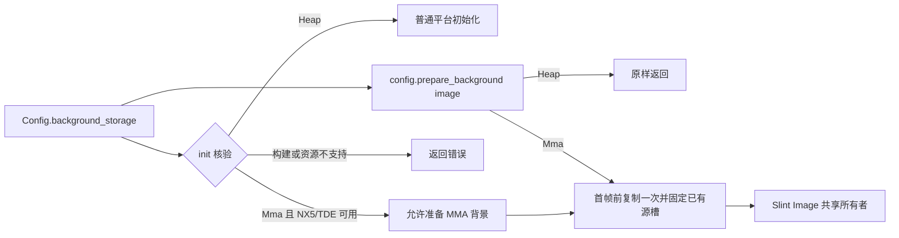
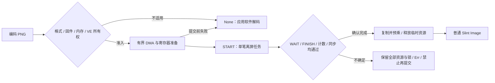
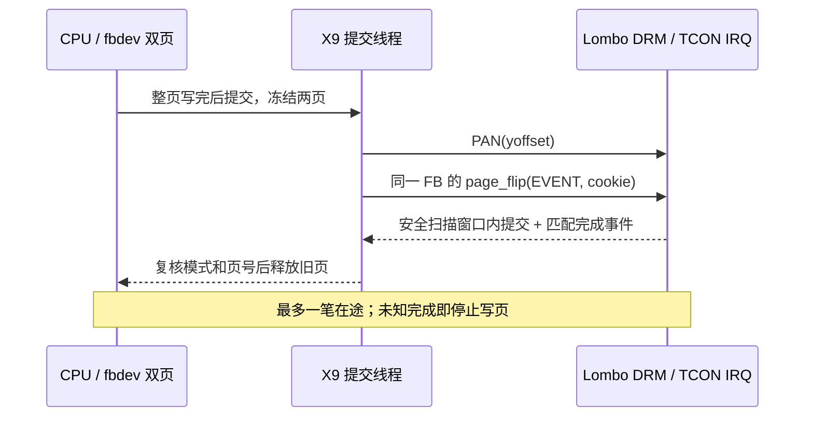
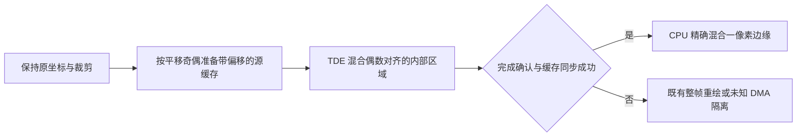
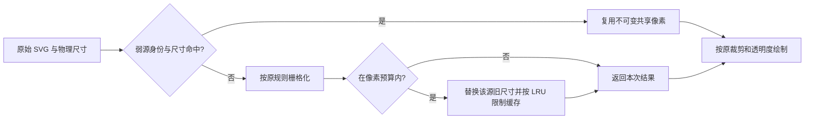

# Rust 公共平台层

本文描述当前源码的接口与运行行为。NX5 使用板级阻塞翻页双页实现，不按固定固件版本或文件摘要准入；`fbdev` 目前仅接入 X9 Lombo #452 的纯 CPU 双页路径。目标或显示所有权不符合要求返回 `DisplayNotAdmitted`，SDK 加载和设备 I/O 失败返回 `Io`。约 29 FPS、有限 WBC 样本等实机结果属于对应阶段的观测，不代表所有物理帧的无撕裂认证。

`f1` / `f1-g2d` 支持已检查的 RISC-V F1。按用户选定的参考示例方式，
采用 `PAN → WAITFORVSYNC`，不再以缺少提交 ID 完成事件阻止本板运行。
这是一项明确的板级使用约定，不代表旧页硬件退休或无撕裂已被独立证明。
`f1-g2d` 额外使用已做离屏正向验证的 GE normal-mode 画布；构建、部署及
实测范围见 [F1 设备说明](../test-app/devices/f1/README.md)。

`nx1` 支持已检查的 ARM32 sun8i NX1，纯 CPU 渲染，按本轮用户明确选择的
参考 `PAN` 双页约定运行。该固件 PAN 内部等待但丢弃等待错误，标准
WAITFORVSYNC 是空操作；本后端不调用它或有缺陷的 HWC 接口。
运行成功不代表硬件退休或无撕裂证明。见 [NX1 调查与验证](nx1-framebuffer.md)。

日常构建和运行见 [测试工程](../test-app/README.md) 、[NX5 设备说明](../test-app/devices/nx5/README.md) 与 [X9 设备说明](../test-app/devices/x9/README.md)。各轮硬件测量由 [文档索引](README.md) 导航；历史报告中的测试数量、PID 和性能数据不定义当前接口。

## 统一 API

`Config.background_storage` 统一选择背景存储，默认 `BackgroundStorage::Heap`，由 `config.prepare_background(image)` 原样返回普通 Slint 图像，不复制像素或改变透明度。`BackgroundStorage::Mma` 仅支持启用 `nx5-mma-background` 的 ARM32 NX5：在设备初始化前核验构建支持，初始化后还必须有真实 TDE 画布；不满足则报错，不静默改成普通背景。

应用保存一份 Config，调用 `init(config.clone())`，然后在首次 show/run 前调用 `config.prepare_background(image)` 并把结果赋给自己的背景属性。配置不会自动替换其他 Slint Image。MMA 模式每个会话只接受一张与物理画布同尺寸的不透明图像；未按 MMA 模式初始化、重复准备、首次绘制后再准备、不可读像素或不满足尺寸/透明度要求都会返回错误。它消耗传入句柄，但其他克隆或 Slint 资源缓存仍可能保留原堆像素，因此应用应使用未被资源缓存持有的解码图像。

MMA 图像复用已有 0 号全尺寸源槽，克隆共同保留 TDE 分配和 SDK 会话；剩余图片使用另两槽。软件采样读取同一只读映射，已知完成失败继续整帧回退；未知 DMA 的资源隔离与双页完成契约不变。



`nx5-mma-background` 自动包含 `nx5-tde` 并启用同源 Slint 的 `external-pixel-buffer`。所有 Slint 包使用锁文件中的同一 Git 提交，正式构建不需要验证补丁脚本。外部像素 feature 仅支持 Rust/std，明确与 FFI 互斥；未启用时保持普通像素布局。故障注入只在单独的 `nx5-test-hooks` 测试构建中存在。完整用法见 [MMA 背景](../test-app/devices/nx5/mma-background/README.md)，历史实测见 [记录](nx5-mma-background.md)。

外部像素图像的相等性同时比较像素格式、地址和宽高。同地址但尺寸不同的图像仍会更新组件属性；[公共接口回归](../test-app/tests/external_background.rs) 覆盖 RGB、RGBA 与预乘 RGBA，以及仅宽度或高度变化的情形。

入口为 `slint_bridge::init(Config)`，在 UI 线程创建 Slint 组件前调用。公开类型由 [src/lib.rs](../src/lib.rs) 导出：`Config`、`BackgroundStorage`、`Error`、`Backend`、`Rotation`、`InputDevice`、`KeyBinding`；`selected_backend()` 返回编译期选择，不代表已经通过设备准入。

| `Config` 字段 | 默认值 | 当前约束 |
| --- | --- | --- |
| `framebuffer` | `/dev/fb0` | 可配置任意 framebuffer 设备路径或设备链接 |
| `inputs` | 空列表 | 至多一个 `Touchscreen` 和一个 `Keys` |
| `rotation` | `Rotation::None` | 固定为不旋转或顺时针 90、180、270 度；90/270 度交换逻辑宽高 |
| `background_storage` | `BackgroundStorage::Heap` | 普通模式保留原图像；MMA 仅限已启用能力且资源可用的 ARM32 NX5 |
| `frame_interval` | 16667 微秒 | 非零且可加到单调时钟；约束两次渲染启动的最小间隔 |

帧间隔不是 60 FPS 性能承诺。NX5 原样使用该配置，没有专用 33334 微秒钳制；显示页仍只在提交成功完成后复用。`init()` 在设备初始化前检查帧间隔和输入数量，随后执行板级准入、打开 framebuffer 与输入，最后安装 Slint 平台。

`init()` 返回本库的 `Error`。组件创建及 `run()` 返回 Slint 的 `PlatformError`；循环中的输入、绘制和提交错误会转换为其错误消息。退出前仍会等待在途提交；若 UI 已出错、该提交也失败，最终错误以 `PresentationFailed` 为主并保留原 UI 错误原因。提交成功时仍返回原 UI 错误；重复读取同一提交失败不会重复拼接原因。提交失败使该显示实例保持失败状态，不能通过重新运行循环恢复页所有权。

每个平台实例只允许创建一次全屏根窗口；即使释放该窗口，也不能在同一平台上创建第二个。重试和再次运行复用同一组件，不允许嵌套运行事件循环。输入至多一个触摸设备及一个按键设备。根窗口应使用响应式布局；可用 `preferred-width`、`preferred-height` 表达偏好，不能固定成与旋转后的逻辑屏幕矛盾的大小。约束不匹配时返回错误。

`InputDevice::touchscreen(path)` 查询 EV_ABS 能力，支持 NX5 的 `ABS_X/ABS_Y + BTN_TOUCH`，以及 X9 的无 slot Type-A `ABS_MT_POSITION_X/Y + ABS_MT_TRACKING_ID`。Type-A 在 `SYN_MT_REPORT` 收齐单个触点、在 `SYN_REPORT` 更新指针，保持首个 tracking ID；主指抬起后等所有手指抬起，避免剩余手指误触。轴范围由 ioctl 查询，先归一化到物理屏幕，再逆变换为未旋转的 Slint 逻辑坐标。触摸按下、移动和释放只在 `SYN_REPORT` 后发送，避免把接触事件与尚未收齐的坐标组合。收到 `SYN_DROPPED` 后忽略事件直到报告边界，再用 `EVIOCG*` 查询状态，修复按键及接触状态；Type-A 没有可查询的 slot 快照，丢包后清除未完成包；BTN_TOUCH 为 0 时释放，否则等下一完整帧恢复主触点。依据 [Linux evdev 规范](https://docs.kernel.org/input/event-codes.html#ev-syn)。

`InputDevice::keys(path)` 提供方向、确认、返回等导航键。产品可通过 `InputDevice::Keys { path, bindings }` 和 `KeyBinding::new(code, text)` 指定 Linux 键码到 Slint 特殊键或字符的映射。它处理按下、自动重复和释放，不提供键盘布局或输入法。自定义按键映射要求 Linux key code 小于 768、彼此不重复，且映射文本非空；不满足时返回 `InvalidConfig`。输入掉线会终止事件循环并返回错误，避免持续轮询失效描述符。

每轮对每个输入设备最多进行 8 次非阻塞读取，每次缓冲最多 32 条原始 evdev 记录；这不是 Slint 事件数量或采样频率上限。仍有数据时，描述符保持可读，后续轮次继续处理。该批次限制与业务任务的 2 ms 预算分别执行，避免把输入或任务积压一次性处理到底。

### F1 PNG 加载

`try_decode_png(data: &[u8]) -> Result<Option<slint::Image>, Error>` 是显式的图片加载入口，可在 `init()` 前调用。
它不拦截 Slint 的 `Image::load_from_data` 或 `.slint` 编译资源，也不改变 SVG 解析与栅格缓存。
`f1`、`f1-g2d` 在指定的 RISC-V64 D211 固件上可使用 VE；其他板返回 `Ok(None)`。

- `Ok(Some(image))`：已确认解码完成并完成 CPU 缓存同步，返回普通堆像素图像，临时 DMA、VE client、映射和锁已释放。
- `Ok(None)`：提交前判定不适用，包括编码/尺寸、固件、可用内存、其他 VE 所有者、设备不可用或准备失败。调用者可选用 Slint 软件解码。
- `Err`：完成状态不确定或解码器已被停用。不能重试或据此软件回退；保留进程直到板级恢复确认 DMA 停止。展示程序打印 `F1_PNG_QUARANTINED` 后等待，不用退出进程代替 DMA 退休。

接受非隔行、8-bit RGB/RGBA PNG，至少 32768、至多 614400 像素，单边不超过 4096，编码不超过 2 MiB。
检查 chunk 边界/CRC、IHDR/IEND、连续 IDAT、zlib 头；调色板、透明色键、APNG、其他位深和未知关键 chunk 在提交前返回 None。
RGB 保留 RGB8 存储；RGBA 按 Slint 相同整数舍入预乘，排除行尾 padding。
JPEG 等格式未接入此入口，继续由应用的软件解码器处理。

VE 只使用一笔离屏任务：IDAT 缓冲、32 KiB LZ77 和对齐输出，不分配 MPP 的另一份 packet 副本，不保留解码缓存。
提交前要求 `MemAvailable` 至少覆盖本次 DMA、返回堆图像及额外 8 MiB 余量；这是准入快照，不是系统内存预留。
1024×600 当前背景使用 3428352 B 临时 DMA，返回像素约 2.344 MiB；具体图像按实际编码长度与 stride 计算。
应用可在显示画布创建前加载背景，降低并存峰值。



实现直接使用 F1 VE/DMA UAPI，不加载会忽略 PNG HAL 错误的旧 `libmpp_decoder.so`。
持有独占锁，检查包括本进程在内的 VE 描述符/映射所有者；每笔任务前复位、清状态并消费旧 IRQ 标志。
`WAIT` 的成功状态必须为单独的 FINISH，输出计数必须符合本次尺寸；混合/未知状态、超时或提交后的同步失败均隔离整个 Job。
不把 IRQ 后读到的零状态、固定延时、reset 返回或进程退出当完成证明。
提交前的零超时 IRQ 清理会在本固件内核日志中产生预期 `wait timeout` 行，此时没有在途解码作业。
详细依据及限制见[解码器调查](f1-image-decoder-research.md)，实测见[F1 优化记录](f1-optimization.md#f1-scalar-png)。

## 事件循环

UI 线程通过 [event_wait.rs](../src/event_wait.rs) 使用 `ppoll` 等待 evdev 与 `eventfd`。业务线程通过标准 `slint::invoke_from_event_loop()` 投递任务，或调用 `slint::quit_event_loop()` 退出；唤醒信号与受锁保护的任务队列配合，任务执行时不持有队列锁。

显示提交也通过该 `eventfd` 通知完成。阻塞提交由通用工作线程执行，UI 可继续处理事件并提前绘制一帧到保留画布；页面尚未完成交接时，不写任何 framebuffer 页。退出循环会等待最后一笔提交完成，并丢弃尚未提交的预渲染帧。再次运行时先按组件的当前状态重绘；未提交帧的脏区保留到后续两页修复中，避免旧画面闪回或局部更新丢失。模块分工与实测见 [并行化报告](nx5-performance.md#nx5-parallel)。

销毁整个 `Framebuffer` 时，先等待提交线程结束，再释放保留画布和 TDE 资源，随后释放板级 SDK 会话，最后解除显示映射并关闭 framebuffer 文件。提交返回错误或线程 panic 时也保持该清理顺序。若 TDE 的 DMA 完成状态未知，则原生层保留相关 MMZ 和库引用，通用层同时保留板级 SDK 会话及独占锁至进程退出，避免关闭 SYS 或重新初始化显示影响未确认的硬件作业。


平台只弱持有根窗口，避免窗口保存的 Slint 上下文与平台形成强引用环。事件循环出错时，在等待提交完成后隐藏根窗口，释放可见窗口对组件的强引用，并保留原始错误；同一组件仍可再次运行循环。应用释放组件等所有者、UI 线程退出后，平台及 framebuffer 才会析构，不能只检查直接销毁 framebuffer 的路径。

提交 `949ceb9` 的 [启动实机回归](nx5-validation.md#nx5-startup) 已验证首次显示失败清理、同一组件重试及任务/定时器延迟创建窗口，每个用例运行两轮；十次退出均无 TDE MMZ 泄漏回收，成功呈现的十帧全幅像素检查通过。正常 WBC 与纹理运行也通过。三项 ignored TDE/翻页测试已于 2026-10-12 [独立补齐并通过](nx5-validation.md#nx5-hardware)。输入 EIO 的历史结果仍见 [177c18a 报告](nx5-validation.md#nx5-tde-exit)，未在这次补测中重跑。未知 DMA 完成状态仍按原生 TDE 安全策略保留资源。

NX5 后端提供 10 ms 定时器精度参数，依据 #233 内核的实测分辨率；该参数不是内核版本检查。通用等待模块据此先阻塞、再在最后一个节拍内检查期限与事件，以减少粗粒度睡眠造成的迟到；X9 的高精度定时器实测分辨率为 1 ns，传入零参数，只阻塞等待。精确检查会增加 CPU 用量，不参与页面退休判断，见 [调度测量](nx5-performance.md#nx5-scheduling)。

每轮更新 Slint 定时器与动画、执行一批业务任务、处理输入并检查窗口约束，再按最小帧间隔绘制。业务任务每批最多 128 个，并在每个回调返回后检查 2 ms 执行时间预算；到限后先处理输入，未开始的任务按 FIFO 留在队列。每轮至少允许一个任务执行，避免无进展；回调执行时不持有队列锁。单个回调不能被抢占，因此 2 ms 是批次让出阈值，不是触摸延迟的硬性上限，耗时业务仍应放在工作线程。

渲染结束后立即返回事件循环，先处理期间到达的输入，再开始 framebuffer 写入。写页采用约 1 ms 的软预算，每累计约 8192 像素对应的完整行检查时间；至少完成一行，不在行内中断。未写完时继续下一轮输入处理，不睡眠、不重新渲染保留画布；整页完成后才提交后台 PAN。单次 Slint 渲染与输入回调仍在 UI 线程同步执行，预算不构成硬实时保证。自动 evdev 对照及验证范围见 [输入延迟优化](nx5-performance.md#nx5-input-latency)。

任务积压时等待超时设为零，不因 `eventfd` 通知已读走而睡眠；`eventfd` 只用于唤醒，任务仍由受锁保护的队列保存。没有未完成写页、待执行任务和等待期限时才无限等待事件；期限由 Slint 定时器，以及可继续绘制时的动画／重绘请求共同决定。预渲染容量已满时，先完成该帧的写页与提交才能继续绘制，输入和业务任务仍可唤醒 UI。退出或出错会关闭任务接收并清理未执行任务；后续投递返回 `EventLoopTerminated`。同一组件重新运行循环时会重新开放队列。

2026-10-12 的队列延迟回归使用真实事件循环、内存画布和 evdev 管道：排入 64 个各休眠 2 ms 的回调，在首个回调内送入完整触摸包，记录 Slint 点击回调执行时间。修复前主机等待 64 个回调、约 131.5 ms；修复后等待 1 个回调、约 2.1 ms，全部任务仍按 FIFO 完成。相同隔离回归在 NX5 #233 上通过，观测约 7.3 ms；板上的睡眠精度和线程调度会影响该数值。另验证清空唤醒后续投递、批次剩余任务以及回调跨线程重入/退出。此实验不加载厂商 SDK、不操作物理触摸设备或显示页，不代表触摸到屏幕扫描的端到端延迟；该隔离回归阶段未切换常驻显示程序；后续已完成 [新版部署和实体触摸验证](nx5-validation.md#nx5-touch-response)。原始日志、构建与部署档案位于本地 `evidence/nx5-touch-wake/2026-10-12/`，需另行取得。

## 窗口创建与显示失败

允许在 `slint::run_event_loop()` 启动后，由排队任务或 Slint 定时器创建首个根窗口。尚无窗口时，循环仍处理任务、定时器并持续读走输入，暂不分派窗口事件或渲染；存在未执行任务时不进入无限等待。窗口出现后按原有双页路径绘制，平台仍只保存窗口弱引用。

Slint 在调用板级 `set_visible(true)` 前已保留组件的可见引用。布局约束不匹配时，适配层在返回原始错误前调用 `hide()`，使首次 `show()`/`run()` 失败也恢复为不可见并释放该引用。回滚期间只阻止 Slint 为“最后一个窗口关闭”临时请求的自动退出代理；安装时保存的公共代理继续工作，因此不清除用户主动退出请求，也不丢弃启动任务。修正同一组件的约束后可重新显示并运行。


[生命周期回归](../src/tests/framebuffer_lifecycle.rs) 验证首次显示失败后 TDE → SDK 析构与映射释放；[启动回归](../src/tests/runtime.rs) 验证连续失败后的隐藏状态、修正后实际像素、已排队任务、显式退出，以及任务积压/定时器中的延迟窗口创建和循环内显示失败重试。新增用例均先在 `177c18a` 上复现失败，再验证修复通过。

## Framebuffer 软件路径

CPU 图片绘制由 [texture_renderer.rs](../src/texture_renderer.rs) 在 Slint 已有的 `TargetPixelBuffer::draw_texture()` 接口中处理。纯软件板级路径直接使用它；NX5 TDE、F1 GE 先尝试各自加速，fbdev 先尝试既有背景/旋转缓存，再使用这个公共 CPU 路径。已处理的纹理返回成功，避免再由 Slint 重复绘制；NX5 未知 DMA 或等待整帧回放时，不进入新的 CPU 写画布路径。

公共路径支持 RGB、straight RGBA、预乘 RGBA、四方向旋转和整体透明度，不接管着色及平铺。源视图宽高最多 4095，目标单边最多 32767，源步长和缓冲边界必须有效。采样按 Slint 1.18.1 的 Q8 步长计算；因绘制接口只有脏区、没有原始裁剪起点，只接管步长是 16 的倍数的比例，使任意整数裁剪起点的 Q4 偏移保持精确。其他输入在写像素前返回未处理，交回 Slint。

90°/270° 且目标两边至少 64 像素时，以 32×32 分块改善源列读取的局部性。每个绘制行段按最多 32 个像素采样到 128 字节栈缓冲，再做连续混合；全不透明批次直接复制，其余使用与 Slint 一致的整数取整。Cortex-A7 构建可将该连续混合编译为 NEON；其他架构保留同一整数语义。该路径没有新增堆图像缓存、线程或物理页，不改变提交完成契约。

适配层不再调用 Slint 扩展的 `TargetPixel::blend_sampled_slice`。锁定的 Slint 已通过 `10f2c8b`、`796ea9f` 撤销原批量混合和旋转分块，适配层未接管的纹理使用 Slint 原有逐像素路径。缓存身份、MMA 外部像素及空图片相等性修复仍保留；不能直接换成官方同版本源码，也不把历史 Slint 优化的帧率当作适配层新实现的成绩。回归通过绘制接口比较四种旋转、三种像素格式、全量/保留重绘、裁剪、缩放、透明度、写时复制及源替换，另校验混合短尾和保护像素。

`fbdev` 在保留画布前增加一项不透明背景缓存（[实现](../src/software_background.rs)）。仅处理目标恰好覆盖整张画布、整体 alpha=255、无着色和铺排的共享 RGB/RGBA 图片；RGBA 源视图还须全部不透明。缓存保存按当前旋转、裁剪源视图及 Slint 定点采样规则得到的物理方向像素，命中时只复制本帧脏区，随后前景照常叠加。源身份、源视图、画布尺寸或旋转变化会重建缓存；身份键保留不可变源存储，源像素写时复制不会误命中旧内容。

派生像素最多 4 MiB，此外保留一份源图共享引用；X9 800×1280 使用 3.90625 MiB。每帧最多检查一张候选图片，避免多个全屏层反复替换。为保持嵌套裁剪的取整一致，只接受 Q8 采样步长为 16 的倍数、源视图宽高不超过 4095 的情形；其他尺寸、透明源、不支持的格式或分配失败先尝试公共 CPU 纹理路径，未处理时交回 Slint。缓存不写物理页，不增加线程或在途帧，也不改变 NX5 路径。回归覆盖旋转、局部重绘、源替换、裁剪、隐藏、透明度和尺寸变化，见 [缓存差分测试](../src/tests/software_background.rs)。

`fbdev` 还为重复使用的等尺寸图片提供[旋转纹理缓存](../src/software_texture.rs)。准入限于 90°/270°、源视图宽高均不少于 64、无着色/铺排、整体 alpha=255 的预乘 RGBA；旋转后尺寸必须与目标严格一比一。缓存保留原始逐像素 alpha，按当前裁剪区和平移位置读取连续像素，调用适配层公共批量混合及不透明批次复制，不缓存文字、选中边框或已经与背景合成的整张卡片。

旋转缓存使用两个最近使用槽位，每槽派生像素不超过 512 KiB，总计不超过 1 MiB，另保留最多两份源图共享引用。首次遇到源身份/视图与旋转组合时只记录身份，第二次使用才生成像素，以减少连续变化的 SVG 栅格或一次性源的无效生成。源替换、写时复制及裁剪源视图变化按新键处理；缩放、整体透明度、其他格式、超预算或分配失败沿用原绘制。当前富列表两张纵向底图占 700 KiB，横向两张占 625.25 KiB；方向切换会替换槽位。此预算独立于全屏背景的 4 MiB，不新增线程、物理页或在途帧。回归分别对全量与保留重绘模式进行缓存前后像素对照，见[旋转缓存测试](../src/tests/software_texture.rs)。

软件渲染使用 Slint `SoftwareRenderer` 的 `ReusedBuffer` 模式。纯软件在堆中保留一份预乘 RGBA 图像（4 字节/像素）；ARM `nx5-tde` 初始化成功时改用 SDK 分配的 cached MMZ 画布。`FY_MPI_SYS_MmzAlloc_Cached` 同时返回物理地址与 CPU 虚拟映射；Slint 软件绘制访问虚拟映射，TDE 使用同一块内存的物理地址，不再另存堆画布或在每次硬件操作后拷回。作业前同步 CPU 缓存，阻塞 `EndJob` 成功并完成作业后缓存同步后才恢复 CPU 访问。画布通过 `TargetPixelBuffer` 分派符合条件的硬件操作，其余由软件绘制；初始化不可用时仍使用堆画布。显示输出限定 packed true-color：RGB565，或 RGB 三通道各 8 位的 32 位布局，可含 8 位 alpha。通道位置由 framebuffer 位域解析；重叠位域、非标准格式、错误 stride、硬件旋转和不足两页的布局均拒绝。

两条路径均在预乘 RGBA 画布中混合。写入含 8 位 alpha 的 framebuffer 时，RGB 精确反预乘为 straight RGB，通用格式保留原 alpha；alpha=0 写零，alpha=255 直接复制 RGB 通道，其余使用共享倒数表，结果等于 `min(255, (channel × 255 + alpha / 2) / alpha)` 的整数除法。NX5 当前板级显示契约使用 0–128 的逐像素 alpha 量程：写页时按 `round(alpha × 128 / 255)` 编码（等于 `(alpha + 1) / 2` 的整数除法），0 为全透明、128 为不透明。该量程来自实际 WBC 色块比较，不能从 8 位 alpha 位域推断；Slint 画布与 TDE 运算仍使用标准 0–255 alpha。NX5 的 BGRA 位域路径只在目标页交换红蓝并编码 alpha，不修改源画布；不透明和全透明连续区域分别使用独立的 16 像素 NEON 快路径，避免半透明计算的寄存器压力拖慢它们。半透明区域对 8 个像素复用 Q16 倒数，按颜色通道执行向量乘法、舍入收窄和饱和；同一组 alpha 相同时只查表一次。输出 alpha 为 128 或 255 量程时均逐字节等于原整数算法，短尾部及其他量程保留标量路径。算法和实测见 [NEON 反预乘优化](nx5-performance.md#nx5-neon-unpremultiply)。RGB565 或无 alpha 的 RGB888 输出保留预乘 RGB，相当于黑底合成，不能透出下层视频。位域转换按主机原生字节序写入，保留行尾 padding。

通用 BGRA8888 写页在 alpha 量程为 255、源/目标均按 4 字节对齐且片段不少于 16 像素时，先按整段检查 alpha。全不透明段批量交换 R/B，避免逐像素反预乘分支；含透明像素、短段、不对齐地址及其他格式保留原路径。该优化不修改源画布、不分配缓存，且仍位于完成等待后的写页阶段；NX5 TDE 的既有转换入口优先执行。 X9 接入及这些共用改动在当前 NX5 部署上的验证范围见 [NX5 链路回归](nx5-validation.md#nx5-x9-regression)。

F1 的 BGRA8888、255 alpha 量程增加 64 位整数写页路径：每次处理四个不透明像素，合并 alpha 检查与 R/B 交换，不分配缓冲。
两侧均 4 字节对齐且具有相同 8 字节对齐偏移时，先处理一个必要的前导像素，再使用成对 64 位读写；尾部继续标量处理。
遇到透明像素、不匹配对齐或其他布局时，原路径重写整段，包含优化路径可能已写的前缀。
这是普通 RV64 整数操作，不启用 NEON、RVV 或全程序玄铁 feature；物理页保护和分段提交规则不变。
ISA 依据见[指令集调查](f1-isa-research.md)，效果见[F1 实测](f1-optimization.md#f1-scalar-png)。

应用需要透明区域时，在 `.slint` 根窗口设置 `background: transparent;`，并避免用不透明全屏背景覆盖开口；局部颜色 alpha 也会保留。透明 UI 通过独占设备的 `alpha-regression` 验证实际页与黑色 VO 底层上的 WBC 合成；视频解码和业务视频层尚未接入。视频接入方式未定，当前 SDK/VO 独占所有权、初始化和关闭流程保持原有约束。实际视频集成仍须验证非黑色视频底层、图层配置及共用会话生命周期；新增设备/固件还须重新核验 alpha 量程。历史背景见 [slint-nx5 经验](nx5-display.md#slint-nx5-lessons)。

图片背景上的多个矩形开口由测试工程的应用组件 `BackgroundWithHoles` 实现：通过公共模型 API 计算背景可见矩形，用标准 `clip` 和偏移 Image 绘制；前景继续按普通 Slint 顺序叠加。根窗口透明、源图原尺寸绘制及模型约束见 [应用用法](../test-app/README.md#图片背景中的多个透明区域)。这不增加库接口、renderer 钩子或提交后的清屏步骤；页所有权和完成契约保持原有实现。NX5 物理双页和交互验证见 [背景裁剪报告](nx5-validation.md#nx5-background-holes)。

两页首次使用时写入完整的软件图像；随后逐行合并本帧与前一已提交帧的实际脏区，跳过不相交区域之间的空隙，修复交替显示页中遗漏的变化。空脏区不触发提交。只写不可见页，提交契约成功返回后才改变前后页身份。若提交结果不确定，缓冲区进入禁止写入状态，后续重绘返回错误。

分段写页保存本帧脏区、两帧合并区域及下一行位置，不增加画布或物理页。期间保留画布不可改写，输入回调只更新应用状态，后续帧再绘制这些变化；整页写完才执行提交前的内存屏障。退出或错误若放弃部分写入，则将后台页标为未初始化，并保留该帧脏区，保证再次运行时重建后台页及修复另一页。

绘制与提交已分开：同时至多一笔在途提交和一帧已准备画布；页号、初始化标记及历史脏区仅在完成确认后更新。布局约束及初始化完成同步通过私有板级契约提供，通用工作线程不包含设备驱动调用。

CPU fence 不等于 DMA 缓存一致性。设备专有实现仍须负责缓存维护、垂直消隐锁存和旧页不再被硬件读取的完成条件。

## 准入边界

`nx1` 分派到 [NX1 后端](../src/backends/nx1/mod.rs)，要求 ARM32、
`3.4.39 #1 Fri Mar 25 14:53:50 CST 2022`、`Hardware: sun8i`，
以及本次检查的 1024×600 BGRA8888 双页布局（虚拟高度 1200、
stride 4096、物理基址 `0x43100000`、长度 4915200）。
获取会话锁，检查其他进程的 framebuffer/disp 描述符、映射及 framebuffer console，
并核验实际打开的 framebuffer 设备。已有所有者时拒绝，不自动停止它。
在任何像素写入前，对当前页执行一次参考 PAN；此后交替两页，
每次 PAN 前后核对布局与偏移。可见的 ioctl 错误、模式变化或非交替提交
均停止后续写页，不重试失败的提交。

NX1 使用通用保留 RGBA 画布、CPU 纹理绘制和脏区写页，不加载 SDK、
使用 HWC、分配加速器 DMA 或改变其他板的准入。内部等待错误被固件吞掉，
所以 PAN 返回和页号读回仍不足以证明硬件退休；这是本轮明确选择的
参考约定，不是可靠完成接口。`SLINT_BRIDGE_TRACE=1` 输出成功返回的
PAN 提交数、提交 FPS 与平均调用耗时，不代表面板无撕裂帧率。
构建和操作前提见 [NX1 设备说明](../test-app/devices/nx1/README.md)，
固件缺陷和实测边界见 [NX1 报告](nx1-framebuffer.md)。

`f1` 分派到 `src/backends/f1/`，核验 RISC-V64、D211 compatible、
已检查内核标识及 1024×600 BGRA8888 双页布局（stride 4096、物理基址
0x42440000、长度 4915200）。获取会话锁，并检查其他进程的 framebuffer
描述符/映射及 framebuffer console；已有显示所有者时拒绝，不自动停止它。
打开配置的 framebuffer 后再次核对真实设备和布局，在任何写页之前对当前页
执行一次参考 PAN/VSYNC 序列。之后严格交替两页，每次先复核当前页和布局，
PAN 成功后等待 VSYNC，再读回复核；任一步失败都会使通用提交器停止后续写页。
初始同步及读回只是该参考约定的步骤，不能补足硬件提交归属证明。

采用该约定是本轮用户明确选择，适用于本次已检查的 F1，不放宽 NX5/X9 的
完成契约。最多一笔在途提交、一帧预渲染及失败后停止写页的通用约束不变。
[当前镜像分析](f1-kernel-analysis.md) 中的限制仍成立：普通 PAN 丢弃更新错误，
VSYNC 等待共享标志，所审计 DE IRQ 不处理 CFG_DONE。不能把运行成功宣称为
针对所有扫描帧的无撕裂认证。`SLINT_BRIDGE_TRACE=1` 每约一秒输出成功提交
累计数、单调时钟、提交 FPS 及 PAN/VSYNC 平均耗时；它不是面板刷新率。

[src/backends/mod.rs](../src/backends/mod.rs) 将 NX5 分派给 [src/backends/nx5/mod.rs](../src/backends/nx5/mod.rs)。检查 ARM32，再获取进程锁、检查 VO 未被占用并加载厂商库。不读取内核版本、构建时间或 framebuffer 驱动名称，也不计算 SDK、fyfb、vou 文件的 SHA256；兼容重编译不再因这些元数据变化被拒绝。库加载本身具有 SYS/VO 初始化副作用，不能与其他 SDK 进程并用。[current-target.json](../test-app/devices/nx5/current-target.json) 仅保存带时间戳的环境观测，不控制代码准入，也不实时更新设备状态。

SDK 按无版本库名 `libVideoDec.so` 交给系统动态加载器查找，可在启动进程时用 `LD_LIBRARY_PATH=/任意/SDK目录` 指定位置；代码不再要求 `/system/app/clib`。若 SDK 文件自带版本后缀，在该目录提供 `libVideoDec.so` 链接即可，后端不限制实际文件的版本名称。首次加载后若 SDK 构造函数已启用 VO，就接管该次引用；若库已驻留且 VO 未启用，或构造函数不自动启用，则调用一次 `VO_Enable()`。初始化后续失败和正常析构均只配对调用一次 `VO_Disable()`；库映像通过 `RTLD_NODELETE` 保持驻留，使 SDK 的 SYS/VB/MMZ 描述符缓存可被后续会话复用，避免重复加载后遗失缓存并累积描述符。这不保留正常会话的 VO 引用或独占锁；锁竞争返回 `DisplayNotAdmitted`，其他锁调用错误仍为 `Io`。VO 检查必需符号与调用结果，TDE 以同一库名及 `RTLD_NOLOAD` 复用会话，不会另行初始化 SDK。调用者仍需提供兼容 `codec/vd/VoApi.h`、TDE 头文件和阻塞 PAN 完成语义的 SDK/驱动；符号存在和布局通过并不能自动证明 ABI 或完成语义兼容。

`fbdev` 分派到 [X9 后端](../src/backends/x9/mod.rs)，只接受 ARM32、已核验的 `3.10.100 #452 SMP PREEMPT Mon Dec 12 11:32:50 CST 2022` 固件、`lombo` DRM 1.0.0 和 800×1280 / 虚拟 800×2560 的 BGRA8888 双页布局。获取会话锁和 DRM master，将控制台置为 graphics，避免 fbcon 写页；核对实际 framebuffer fd 的 sysfs 设备与 DRM 相同。打开 framebuffer 后重新核对当前页，并在任何像素写入前等待一次匹配 flip 事件；不能沿用打开 framebuffer 前的页号。

X9 不加载厂商 SDK、不分配 DRM dumb buffer，也不使用 G2D。CPU 通过 `/dev/fb0` 写既有后台页；提交先 PAN 设置 yoffset，再对同一个 DRM FB ID 请求 `DRM_MODE_PAGE_FLIP_EVENT`。只有长度、类型、64 位 cookie 匹配的完成事件及模式/偏移复核成功后，旧页才可复用。普通 vblank、读回页号、固定延时、超时、EOF、错配或多余事件均不能判为完成；两秒是失败期限。旧内核事件末尾为 reserved，厂商 sequence 恒为 0，不依赖这些字段。发生不确定提交后停止写页且不恢复文字控制台，待板级恢复；正常结束恢复原控制台模式。目标调用链、实机事件验证及扫描输出限制见 [X9 接入报告](x9-framebuffer.md)。



完成提交的回调及内存显示替身均为 crate 私有，应用不能注入回调、构造“已验证”标记或选择公开的无检查显示路径。内存替身用于测试像素、页生命周期和完整事件循环，不能证明物理屏幕行为。

NX5 打开 `Config::framebuffer` 指定的设备，通过 `FBIOGET_FSCREENINFO` / `FBIOGET_VSCREENINFO` 获取实际分辨率、stride、像素位域、虚拟尺寸和显存容量，使用前述通用布局校验，不限定 1024×600 或固定 stride。尺寸由设备当前模式决定，要求至少两页完整容量；两页偏移为 `0` 与实际 `yres`。初始化布局传给提交线程；每次 PAN 前核对尺寸、stride 和像素格式，读回后再次核对尺寸/格式与目标页，布局变化或无效偏移会终止提交。提交线程调用阻塞 `FBIOPAN_DISPLAY`，成功并读回目标页后才复用旧页；不提供单缓冲或忽略错误的回退。页号读回用于错误检测，不作为硬件退休证明。其他设备仍须提供与驱动匹配的实现和验证。TDE 不再以 1024×600 限制画布大小，仍检查尺寸溢出、SDK 对齐及作业完成状态；SDK 不支持或无法分配时使用既有软件回退。TDE 绘制范围由 [tde/mod.rs](../src/backends/nx5/tde/mod.rs) 与 [native.c](../src/backends/nx5/tde/native.c) 实现，说明及历史像素比较见 [TDE 报告](nx5-performance.md#nx5-tde)。使用 `nx5-tde` 构建时，板级像素类型保持 Slint 预乘 RGBA 语义，对圆角矩形等操作内部的连续同色混合使用 CPU 批量路径；Cortex-A7/NEON 预设启用 8 像素向量混合，尾部及无 NEON 构建使用同一精确整数算法，不改变 RGB 的 `/255` 向下取整或 alpha 的原有舍入。不透明填充保留 Slint 的批量填充。此 CPU 路径不提交 DMA，不依赖 TDE 作业成功；图片 TDE 复制/混合及未知 DMA 隔离仍按原有契约执行。

`nx5-tde` 的等尺寸 RGBA 纹理支持整体透明度。上传时按 Slint 顺序计算：straight RGBA 先合并逐像素/整体 alpha，再预乘 RGB；预乘 RGBA 直接缩放四个通道；整体透明度为 255 时只复制已有预乘字节。Cortex-A7 预设使用 NEON；其余构建使用相同整数规则。准备后的缓存键包含透明度；混合图像还区分平移的 X/Y 奇偶位置，不透明复制可跨奇偶位置复用。源槽的替换先使用空槽，再按最后使用的绘制帧淘汰；同帧使用的纹理优先保留像素量较大的源，避免小前景反复挤掉全屏背景。离开活跃集合的大图可在后续帧被淘汰。保留两个完整源槽，并增加一个小槽，容量为画布 RGBA 字节数的四分之一加完整槽的 padding 余量；Rust 和 C 均按最坏对齐尺寸检查准入，大图仍只能使用两个完整槽。SDK 的全局 alpha 开关不符合该预乘语义，因此不使用。对于奇数位置或裁剪，源缓冲增加 0/1 像素偏移，使 TDE 处理范围内的偶数对齐主体；提交成功并完成缓存同步后，由 CPU 精确处理最多一像素的边缘条带。不移动 UI，也不扩大裁剪或写入邻接像素。混合仍限定不透明目标；Cortex-A7 通过 NEON 批量检查 alpha，尾部及其他目标使用同一标量规则。SDK 可能把不透明输出 alpha 舍入为 254，因此作业成功并完成缓存同步后仍须精确恢复到 255，避免写页反预乘放大 RGB 误差；该回写使用 NEON 批量路径，标量尾部保留相同语义。单次 RGB 容差仍为 1/255。MMA 背景被显式准备后，0 号槽固定为只读且退出普通淘汰集合；其他图片只用 1 号全尺寸槽与紧凑槽。两个完整源 MMZ 各预留 `(画布宽 + 4) × (画布高 + 2) × 4` 字节以覆盖对齐，1024×600 上比原分配合计增加 40 KiB（按页分配）；另一个小源槽按同样的对齐余量分配，1024×600 上额外使用 620 KiB，总运行 MMZ 为 12760 KiB / 6 块。画布和物理双页大小不变。未知 DMA 完成时仍禁止 CPU 处理边缘。

奇数坐标透明纹理的内部顺序如下；只有完成确认成功后才允许 CPU 处理边缘：



`SLINT_BRIDGE_TDE_FILL=1` 在 `nx5-tde` 构建中显式开启 QuickFill 对照路径：纯色窗口背景和无圆角/边框的不透明整数矩形可进入硬件，至少 32768 像素、至多 16 个裁剪区域；背景清除可保留预乘 alpha。其他值或未设置时使用 CPU 批量填充，因为共享 MMZ 后重新测量的 22 组面积/形状/颜色对照仍均为 CPU 更快；全屏 CPU 写 MMZ 约 1.69 ms，TDE 含提交和同步约 2.86 ms。硬件填充直接写共享画布，同样遵守完成确认、失败回退及未知 DMA 隔离，不增加 MMZ 块。`SLINT_BRIDGE_TRACE` 的 TDE 行末新增 `fill` 次数；`software` 仍只计未加速的纹理回调。初次接入记录见 [填充与整体透明度实测](nx5-performance.md#nx5-fill-blend)，共享画布复测见 [MMZ 实测](nx5-performance.md#nx5-shared-canvas)。

共享画布上的已知完成错误可能留下部分硬件结果：立即禁用 TDE，将当帧剩余软件回调导向一行预分配隔离区；本次 renderer 调用返回后，以 `NewBuffer` 全量软件重绘同一 MMZ 画布，再恢复原 repaint 模式并提交完整脏区。画布持有 SDK/MMZ 所有权，禁用加速不会提前释放它。未知 DMA 完成时，后续回调同样不能访问画布，整帧返回错误，不写物理页；保留原有 MMZ、SDK 会话及显示锁隔离。该策略不分配整帧备份。

已知 DMA 完成后的 MMZ 释放失败会永久关闭进程内 TDE 创建门闩，后续使用软件路径；同一地址不重复释放，避免部分释放后重复分配累积资源。未知 DMA 仍保持原有整帧失败与会话隔离。

## 构建依赖

F1 构建使用 `.cargo/f1.toml` 和 `riscv64gc-unknown-linux-gnu`，链接到
`/opt/F1` T-HEAD 工具链与 LP64D sysroot。`f1`、`fbdev`、`nx1`、`nx5` 两两互斥。
`f1-g2d` 包含 `f1`；同源 renderer 的 `experimental` 接口由库统一启用。
F1 不切换 Slint 源码、不链接 NX5 SDK，也不加载参考工程中的视频解码库。

`f1-g2d` 用 `/dev/dma_heap/reserved` 分配一份预乘 RGBA 保留画布，
通过 `/dev/ge` normal mode 提交同步作业；不加载 MPP 解码/VO SDK，
不让 GE 访问两张物理显示页。初始化失败且尚未提交作业时可回退堆画布。
仅接受 normal mode=0、version=0x100，另保留一行故障隔离缓冲。
不透明、无圆角/边框的纯色矩形在至少 32768 像素、至多 16 个裁剪块时
仍可走 GE 填充。其余矩形保留软件行为。

等尺寸、无旋转/平铺/染色的 RGBA 图片走直接行路径：先与实际裁剪和画布
求交；预乘输入按整体透明度缩放，straight 输入先合并 alpha 再预乘。
软件混合与 Slint 的整数规则一致。不透明全屏背景只记住不可变共享源的身份
及 opacity 判定，直接复制裁剪行，不保存第二份全屏像素；源改变重新检查，
本帧不再使用时释放该身份引用。缩放、旋转及 RGB 输入先尝试上文的公共 CPU 纹理路径；
超出该路径采样条件、染色、平铺和 AlphaMap 等再交给 Slint。

对较小且反复使用的透明图片，GE 混合另保留两个惰性分配的源槽，每槽
512 KiB、合计最多 1 MiB。RGBA 源上传行跨度补齐到 8 字节，补齐后的行像素数
乘以高度不得超过 128K，单边不超过 4096；可见面积
至少 32768 像素，平均每个裁剪块至少 16384 像素。共享源身份及整体 alpha
共同作为缓存键，按绘制帧复用/替换；不再参与本帧绘制的源身份会释放，
DMA 槽容量保留到画布销毁。新源先按软件相同顺序准备预乘像素，稳定源不重复上传。
上传行偏移与提交 stride 使用同一个补齐布局，行尾 padding 清零，逻辑宽度和 crop 不变。
例如 379×237 使用 1520 B/行，占已有源槽 360240 B；不增加槽数量或分配大小。
补齐后超出槽容量或源分配失败时，在提交作业之前回退软件，未放宽未知完成状态的处理。
这里的等尺寸是指栅格源与目标尺寸相同；SVG 经 Slint 按目标尺寸栅格化后也可进入该路径。

硬件混合仅接受全部目标 alpha=255 的区域；透明目标仍用精确软件路径。
当前固件使用 `alpha_en=1`、`GE_PD_NONE`、预乘 source、非预乘 destination
标志（不透明目标的两种表示相同）。不能照搬 UAPI 注释中颠倒的 alpha_en
说明，也不能将两端均设预乘：当前固件的该组合会产生明显色差。
实机回归支持单次 RGB 误差不超过 1/255；完成并同步后精确恢复目标 alpha=255，
避免物理页反预乘扩大色差。硬件缩放的采样规则没有与 Slint 对齐，本路径不接管缩放。

源上传后执行 DMA-BUF flush（flags=7）；每次 GE 读改写前 flush 目标，
阻塞 ioctl 成功后 invalidate（flags=1），不调用 cmdq 的 `IOC_GE_SYNC`。
任一已提交操作或作业后同步失败会使画布失效并隔离相关 GE、DMA-BUF 与映射；
不再读写画布，不重试、不软件回退，也不提交该帧。两页提交协议不变。
离屏填充、图片混合和缓存用例保留为库内 RISC-V ignored 测试；普通主机测试
不接触硬件。基线与优化结果分别见 [初始 showcase](f1-showcase.md) 和
[F1 性能优化](f1-optimization.md)，构建及设备操作见 [设备说明](../test-app/devices/f1/README.md)。

两个 package 均要求 Linux、Rust 1.92 或更新版本，默认 features 为空，必须显式选择 `fbdev`、`nx1`、`nx5` 或 `f1`，四种板级 feature 两两互斥；`nx5-tde` 包含 `nx5`，`nx5-mma-background` 包含 `nx5-tde` 并自动启用 Slint 外部像素 feature。`nx5-test-hooks` 只用于诊断，不用于正式常驻构建。根 workspace 的默认成员只有库；检查测试工程使用 `-p slint-bridge-test-app`，检查两者使用 `--workspace`。

设备选择由消费应用负责，按以下范围解释默认值：

| 范围 | 默认 feature | 选择方式 |
| --- | --- | --- |
| `slint-bridge` 库 | `[]` | 消费应用在依赖的 `features` 中选择板级功能 |
| 本仓库 `test-app` | `[]` | 仓库命令显式选择设备/能力 feature，如 `fbdev`、`nx5`、`nx5-tde` 或 `nx5-mma-background` |
| 使用指南中的业务模板 | `["nx5-tde"]` | 应用默认 NX5 TDE；切换 X9 使用 `--no-default-features --features fbdev` |

业务默认设备属于业务工程，不改变适配库或测试工程的默认值。`slint-bridge/nx5` 是 Cargo 的依赖 feature 转发语法，不是文件路径；只定义转发项不会启用它，必须通过应用 `default` 或 `--features` 选择。没有选板时的编译错误表示 feature 未启用，不表示 Git 源码未下载。ARM target 选择工具链和 ABI，不替代板级 feature；设备路径和旋转属于运行时 `Config`。

外部业务通过 [适配层 Git 仓库](http://192.168.253.238/wshl/slint_bridge.git) 引用本库，Cargo 将依赖和 SDK 头文件放在 Git 缓存中，无需业务目录内的源码副本。本仓库 `test-app` 的 `path = ".."` 仅用于测试同一工作区的适配层改动，不是外部业务的接入要求。交叉编译器仍由业务工程自己的 Cargo 配置指定；完整独立配置见 [使用指南](getting-started.md#业务工程的交叉编译配置)。

Slint 使用用户指定的 Git 仓库 [Slint 源码仓库](http://192.168.253.238/wshl/slint-last.git)，依赖清单不设置 `rev` 或 tag，跟随仓库默认分支。NX5、NX1、X9 与 F1 统一使用同一来源，保留缓存身份、外部像素等现有扩展，不按设备另分 Slint 补丁版本。依赖关闭默认桌面后端，启用 `std`、`renderer-software` 和 `compat-1-18`。所有板级路径都启用同源软件 renderer 的 `experimental` 目标缓冲接口，以使用适配层的公共 CPU 纹理处理。`nx5-tde` 的 ARM 构建额外编译使用仓库内 `third-party/nx5/include/` SDK 头文件的 C 接口，运行时复用已加载的 SDK 会话。

NX5 的构建默认头文件、观察器链接所需动态库，以及各设备部署用 DejaVu 字体均纳入 [third-party/](../third-party/README.md)，保留来源、版权说明和 SHA256。`NX5_SDK_INCLUDE` 可覆盖默认头文件目录；构建脚本按 package 根目录定位资源，消费方无需设置原开发机器的路径。运行时仍通过 `libVideoDec.so` 和设备动态库搜索路径加载 SDK，不绑定主机资源目录。交叉工具链和 sysroot 仍需按设备配置安装，Rust/Cargo 依赖仍按锁文件获取。

`fontique` 固定到 Slint 当前使用的 0.11.1，并启用 `fontconfig-dlopen`，避免 ARM 构建依赖主机的 Fontconfig 链接配置。没有系统字体库的设备仍需由应用提供字体，例如设置 `SLINT_DEFAULT_FONT` 或在 `.slint` 中导入字体资源。

运行库、软件 renderer、测试所用内部 crate 与 `slint-build` 均引用同一个 Git 地址。`Cargo.lock` 自动记录本次解析的 Git 提交，以支持 `--locked` 和离线复现；这不是依赖清单中的 `rev` 固定。首次构建前联网执行 `cargo fetch --locked`；需要跟进远端更新时执行 `cargo update -p slint`，核对所有 Slint crate 仍来自同一提交后提交更新的锁文件。现有 `=1.18.1` 版本约束仍保留，升级 Slint 版本号时需同步调整相关依赖。

后续升级 Slint 时按功能迁移现有补丁；先检查新版是否已有等价实现，再应用仍需要的补丁，保留独立提交以便追踪。早期纹理优化的增量范围为 `95becfd3d6bc2e840df4956b4004bfef936bfe95..c878901fb9793efc3d515aee37225cbad57de40d`，该范围不代表相对官方 Slint 的全部定制差异。升级验收包括主机 feature 矩阵、缓存/旋转/纹理像素回归、受影响设备的 ARM / RISC-V 交叉构建，以及受影响路径的实机画面、功能和性能对照；补丁应用成功或编译通过不能替代验证。

该版本还修复文字布局缓存淘汰时未通知重绘依赖的问题：否则持续动画后切页可能保留旧标题，而完整截图仍显示新标题。展示应用的保留缓冲回归见 `test-app/tests/showcase_repaint.rs`。缓存容量限制仍保持不变。

该源码还修复软件 renderer 的旋转截图：原生 `Window::take_snapshot()` 按窗口逻辑方向绘制，随后恢复面板旋转及 repaint 模式，避免 90°/270° 的 stride 断言以及 180° 截图倒置。`test-app/tests/rotation_snapshot.rs` 对四个旋转方向比较完整截图，并核对截图前后物理缓冲绘制一致；X9 原生 MCP 使用同一修复。旋转输出的 SVG 使用旋转前的目标尺寸栅格化，再由纹理路径旋转；避免 90°/270° 先交换栅格尺寸造成二次缩放和边缘失真。相同回归还比较四个方向的 PNG/SVG 全图像素。

Slint 中早期的旋转分块和批量混合已撤销，当前实现及回退边界见上文的适配层 CPU 纹理说明。历史热点计时、像素回归和新旧设备对照保留在[纹理优化报告](slint-optimization.md)，不能将不同阶段的结果混用。

该 Slint 版本还缓存运行时 SVG 的栅格结果：按解析源的弱引用身份和请求的物理尺寸匹配，每个源保留一个尺寸，最多 32 项、像素预算 2 MiB。尺寸或源改变会重新栅格化，超预算结果直接返回而不缓存；缓存不保留解析源树，失效源在插入时清除。返回像素仍采用共享缓冲的写时复制语义。没有 `std` 的构建沿用原有直接栅格化路径。



消费方若还有其他库从 crates.io 请求 Slint，应在自己的 workspace 根统一 `[patch.crates-io]` 来源，避免同版本号的不同来源混用；应用的 `slint-build` 也应来自同一树。

## 验证范围

主机测试覆盖以下实际行为：

- 不受支持的后端在设备访问前拒绝；错误帧间隔、布局及 ABI 尺寸检查。
- framebuffer 与触摸设备使用配置路径，布局支持不同分辨率与行尾 padding，触摸轴映射到实际面板尺寸；翻页拒绝错误偏移及运行中的布局变化。
- 真实 Slint 场景输出 RGB565、32 位像素，四种旋转与触摸变换一致，行尾 padding 保持不变。
- 从前台页 0 或 1 启动的交替页脏区修复，准备新帧不修改活动页，空帧不提交，失败后不再写页。
- 字体像素渲染、触摸同步、丢事件重同步、按键重复与释放、设备掉线。
- 真实事件循环接收 evdev 管道、跨线程投递、定时器、动画、退出及再次运行；拒绝不适合屏幕的窗口约束。
- UI 错误与在途提交失败同时发生时保留两个原因，修正 UI 后也不能恢复失败显示实例。
- 在提交成功、失败及 panic 三种情况下直接销毁 `Framebuffer`，检查提交、TDE 和 SDK 释放顺序，并确认映射与文件在最后解除。
- 安装真实 Slint 平台并运行组件，在正常退出、首次显示失败和 PTY 实际 `read()` 返回 EIO 后检查 UI 线程退出确实触发 TDE/SDK 析构；不是手动销毁平台替代应用生命周期。
- 首次显示失败后重试同一组件；延迟创建首个窗口时处理任务积压和定时器，并验证实际呈现的像素。
- 正常退出和布局错误后的再次运行不提交旧预渲染画面；丢弃帧的局部脏区在两页间完整修复。
- SDK 构造函数自动/非自动启用、库驻留与重复获取，以及 framebuffer/输入初始化失败后的 VO 引用配对；未知 DMA 时保留 SDK 会话。
- framebuffer 文件锁竞争返回 `DisplayNotAdmitted`，非竞争锁错误保留原 I/O 分类。

原生 [check-native.sh](../test-app/tools/nx5/tde/check-native.sh) 用主机替身 SDK 验证无版本库名在不同目录下的搜索、`RTLD_NOLOAD` 会话复用及引用释放，同时检查 TDE 故障处理与像素转换边界；不代表新源码已部署或通过实机验证。

[test-app/tools/check-feature-matrix.py](../test-app/tools/check-feature-matrix.py) 对 `fbdev`、`nx1`、`nx5`、`nx5-tde`、`nx5-mma-background`、`nx5-test-hooks`、`f1`、`f1-g2d` 八种组合分别执行 workspace 测试，确认未选板级、冲突组合编译失败，并检查库的 `fbdev` 普通依赖树没有桌面或 GPU 后端。脚本将结果输出到标准输出，不自动写入 `evidence/`。

2026-10-12，`bccf6b9` 阶段记录的测试分布如下。此后的队列延迟修复为各板级 feature 新增 3 项库内主机回归；当前计数以执行结果为准：

| Feature | 库内主机测试 | 独立工程公共接口测试 | WBC 加载/生命周期测试 | 默认忽略的实机测试 |
| --- | ---: | ---: | ---: | ---: |
| `fbdev` | 37 | 2 | 0 | 0 |
| `nx5` | 40 | 2 | 4 | 1 |
| `nx5-tde` | 44 | 2 | 4 | 3 |

`nx5-tde` 还运行启动诊断程序中的一项 Linux framebuffer UAPI 布局测试。

```sh
# 从仓库根执行；不访问真实显示设备。
python3 test-app/tools/check-feature-matrix.py
cargo fmt --all --check
cargo clippy --locked --offline --workspace --features nx5-tde,slint/mcp --all-targets -- -D warnings
cargo doc --locked --offline --workspace --features nx5-tde --no-deps
```

公共接口测试在 [test-app/tests/public_api.rs](../test-app/tests/public_api.rs)；私有回归在 [src/tests/](../src/tests/)、显示/等待模块内及 [TDE 测试](../src/backends/nx5/tde/tests.rs)。SDK/显示专用测试覆盖阻塞翻页、TDE 像素/回退与调用链、演示组件的内存双页对照、填充面积/形状耗时，以及共享画布到真实 framebuffer 的转换写页；需单独部署并独占设备，不能把主机的 ignored 计为通过。另有仅在 ARM 编译的 `neon_writeback_boundaries` ignored 测试，只执行 CPU 转换、不加载 SDK，可在显示程序运行时单独执行。执行命令见 [TDE 报告的构建与接入](../test-app/tools/nx5/README.md#arm-tde-与翻页回归)。

[Framebuffer 析构回归](../src/tests/framebuffer_lifecycle.rs) 使用内存文件、受控提交回调及 TDE 资源替身，不访问真实硬件。[WBC 生命周期回归](../test-app/src/nx5_observer.rs) 使用真实 Slint 应用/定时器、返回错误的平台及受控观察线程，验证错误退出等待和 panic 处理，并通过子进程与替身动态库确认 `LD_LIBRARY_PATH` 加载及配置路径传递；它不替代设备 WBC 采样。

此前 ARM 构建记录为 EABI5 soft-float、最高 GLIBC 符号版本 2.18、未直接链接 Fontconfig 或厂商库；这是对应二进制的检查结果，换工具链或依赖后需重新核对。历史原始记录存放在被 Git 忽略的 `evidence/`，检出仓库后需另行获取。

主机测试验证软件行为；设备性能与输出样本单独记录。历史 #22 固件的 [NX5 无撕裂验证结论](nx5-display.md#nx5-present-validation) 保持原始口径。

UI 截图、元素检查及应用层输入交互使用 [Slint 原生 MCP](slint-mcp.md)。MCP 输入直接进入 Slint，截图重新渲染窗口；它们不能替代 evdev 解码、framebuffer 页生命周期、像素转换及 TDE 故障注入测试。

独立测试工程另提供九页 `showcase`，用法与验证范围集中在 [应用说明](../test-app/README.md#展示应用-showcase)。其 `showcase-preview` feature 仅为应用提供同源 Slint headless 软件预览；正常设备运行仍调用本库 `init(Config)`。标准控件所需的 SVG 解码依赖由测试工程引入，不改变库的 features、默认值、提交契约或设备准入。

当前 NX5 可使用显式的 `.cargo/nx5.toml` CPU 预设和 NEON RGBA→BGRA 写页路径；未使用该预设时仍有原有像素转换路径。生产写页没有使用 TDE：单次格式转换与 CPU 转换后 TDE 搬运只存在于独立诊断探针，所测正确路径更慢，见 [TDE 写页调查](nx5-performance.md#nx5-tde-writeback)。整屏性能及当前驱动提交上限见 [帧率优化报告](nx5-performance.md#nx5-fps)。
