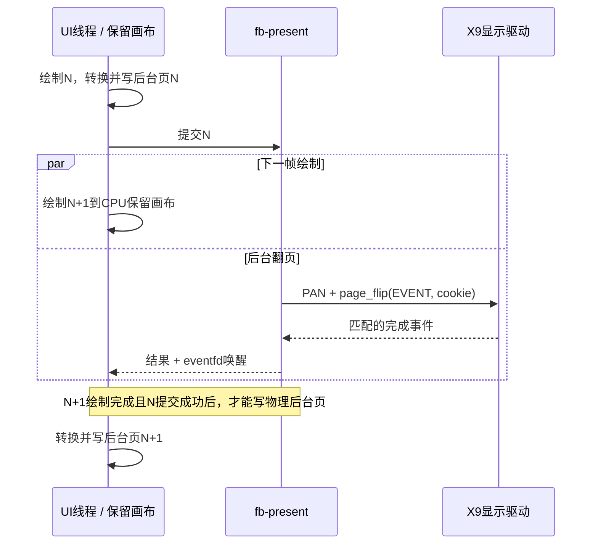

# X9 流水线、NEON 与后续优化分析

2026-10-15，针对 X9 framebuffer 切换、UI 绘制并行性及 NEON 使用情况进行源码、部署 ELF 和历史实测核对。本轮通过 ADB 只读检查当前设备，没有重启 / 替换程序、修改实现、驱动、频率或运行新的性能负载。BackgroundWithHoles 已完成，本轮不继续优化该组件。

## 结论与版本范围

当前实现已经让 **PAN / DRM 完成等待与下一帧 UI 绘制并行**。仍串行的是 **UI 绘制 → 读取保留画布并转换 / 写 framebuffer**：二者均在 UI 线程运行。不是把整个显示过程再移到一个线程就能消除全部串行段。依据是 [runtime.rs:254](../src/runtime.rs#L254)、[presentation.rs:38](../src/presentation.rs#L38)、[framebuffer.rs:676](../src/framebuffer.rs#L676) 与 [framebuffer.rs:751](../src/framebuffer.rs#L751)。

被调查的仓库 HEAD 为 `921d6c00264967ffb5b0305bd0401a2e23771016`。既有部署记录是桥接库 `cacf98f2fedfc99a6d965468cd709adfd7c5466f`、Slint `fa6a6d0158c9730fed62ef1eb1c9730c80214e20`、`showcase-07`，ELF SHA256 为 `0ea44d41b3252118e26cdb501b4401aaeb09456d83303adbd804ce751f12156e`；见 [设备快照:17](../test-app/devices/x9/current-target.json#L17)、[设备快照:57](../test-app/devices/x9/current-target.json#L57) 和 [优化报告:5](x9-optimization.md#L5)。本轮 ADB 在线核验得到相同内核 #452、启动 ID `ebe00047-16a3-4600-89ee-0fe601f48967`、MAC `82:a1:cf:66:54:03`、PID **3103** 及相同 ELF 摘要。`/proc/cpuinfo` 确认双 Cortex-A7 和 `neon`；线程为 UI 主线程、`fb-present`、`async-io`，静态采样分别阻塞在 poll、futex、epoll。线程等待状态仅证明这次静态观察，不用作动态重叠比例。ADB UID 2000 无权读取该 root 进程的 fd 目录，原 Telnet 会话也未成功执行；本轮没有据此进行显示所有权切换。

本次执行 `git diff cacf98f..921d6c0 -- src/runtime.rs src/presentation.rs src/framebuffer.rs src/backends/x9`，输出为空。上述核心运行时、写页和 X9 完成契约与部署源码一致；这不意味着当前整套测试应用的源码、二进制和历史部署完全相同。外部 Slint 当前 HEAD 仍为 `fa6a6d0`；其未跟踪补丁文件不改变已检出的 renderer 源码。

## 每一阶段运行在哪个线程

| 阶段 | 当前执行位置与依赖 | 可重叠范围 |
| --- | --- | --- |
| 定时器、输入、业务回调 | UI 线程，[runtime.rs:219](../src/runtime.rs#L219) | 可与后台显示提交重叠；不能与同线程同步 render 重叠 |
| Slint 布局 / 栅格化，含 90° 采样 | UI 线程，对唯一保留画布调用 `renderer.render()`，[framebuffer.rs:676](../src/framebuffer.rs#L676) | 可与上一帧 PAN / DRM 完成等待重叠 |
| RGBA → BGRA / alpha 转换与物理后台页存储 | UI 线程的 `present()`，[framebuffer.rs:786](../src/framebuffer.rs#L786) | 与下一次 UI render 串行；分段之间允许处理输入 |
| 提交请求 | UI 线程只发送页偏移，[framebuffer.rs:819](../src/framebuffer.rs#L819)、[presentation.rs:110](../src/presentation.rs#L110) | 请求发出后 UI 可准备下一帧 |
| 页模式复核、PAN ioctl、同一 FB 的 legacy DRM flip、poll/read 完成事件、再次复核 | `fb-present` 工作线程，[presentation.rs:59](../src/presentation.rs#L59)、[backends/x9/mod.rs:348](../src/backends/x9/mod.rs#L348) | 与下一帧绘制及输入处理重叠 |
| 完成后的页角色与脏区历史更新 | UI 线程收到成功结果时，[framebuffer.rs:742](../src/framebuffer.rs#L742) | 完成前不复用旧物理页 |

大幅连续滑动、上一帧已经提交后的典型次序是：



该图表达代码允许的重叠，不是本次采集的时序轨迹。短帧是否实际重叠还受最小启动间隔和是否有下一次重绘影响；`frame_interval` 默认约 16.667 ms，不要求每帧固定等待一个该间隔，详见 [runtime.rs:254](../src/runtime.rs#L254)。

## 为什么当前写页不能直接丢到后台

X9 只有一个 CPU 保留画布 `Vec<PremultipliedRgbaColor>`，以及现有的两张 framebuffer 页。[framebuffer.rs:583](../src/framebuffer.rs#L583)、[framebuffer.rs:640](../src/framebuffer.rs#L640) 中没有第二张 CPU 画布。Slint 以 `ReusedBuffer` 使用它，[runtime.rs:35](../src/runtime.rs#L35)；因此画布内既有未变化像素，又有这次局部重绘像素。

写页直接借用该画布并读取像素，[framebuffer.rs:787](../src/framebuffer.rs#L787)。若工作线程同时读取帧 N，UI renderer 同时向其中写帧 N+1，就会产生数据竞争和跨帧混合。`can_render()` 因此要求既没有准备好的帧、也没有未完成写页，[framebuffer.rs:703](../src/framebuffer.rs#L703)。把函数移到工作线程、但保持同一源画布并加互斥锁，只会把等待移到锁上。

写页采用约 1 ms 软预算并按完整行推进；不是同时渲染两个帧。[runtime.rs:268](../src/runtime.rs#L268)、[framebuffer.rs:793](../src/framebuffer.rs#L793)。这一设计保留输入处理机会，但当前单次 Slint render 本身仍连续占用 UI 线程约几十至九十毫秒。故输入响应的主要上限也应首先调查 render，而不是只看写页分段。

真正把写页与下一帧 render 重叠，需要独立且不可变的帧源，例如第二张 CPU 画布或待写脏区快照，还要维护每张画布 / 每张物理页的历史。800×1280×4 的完整额外画布是 **4,096,000 字节，约 3.91 MiB**；脏区快照可较小，但增加复制与内存带宽成本，不能预设净收益。这里讨论的是额外 CPU 内存，不是增加第三张物理 framebuffer。

在途提交期间，两张物理页都不可写；[framebuffer.rs:726](../src/framebuffer.rs#L726) 的 `ready_to_present()` 和 [framebuffer.rs:751](../src/framebuffer.rs#L751) 的 `wait_for_present()` 同时约束它。PAN 返回或读回页号不能提前释放旧页；X9 要求自己提交的 cookie 匹配 32 字节 `FLIP_COMPLETE`，并复核显示模式，[backends/x9/mod.rs:198](../src/backends/x9/mod.rs#L198)、[backends/x9/mod.rs:257](../src/backends/x9/mod.rs#L257)。

已有主机回归直接使用阻塞替身与真实 Slint：在第一次提交仍阻塞时完成第二次 render，断言两张物理页字节完全不变，随后检查交替历史修复，[tests/framebuffer.rs:185](../src/tests/framebuffer.rs#L185)。另有分段写页时冻结画布、未完成页不得提交，以及完成失败后禁止写页的测试，[tests/framebuffer.rs:13](../src/tests/framebuffer.rs#L13)、[tests/framebuffer.rs:245](../src/tests/framebuffer.rs#L245)。本次审计只检查测试源码，未将历史通过记录写成新执行结果。

## 既有 X9 计时说明优先级

下表来自 2026-10-14 至 15 日已归档的 `showcase-07` 优化阶段探针；正式 CPU / FPS 来自另开的正式二进制测量。是同设备、同版本证据，**不是本次重测**。[优化报告:30](x9-optimization.md#L30)、[优化报告:49](x9-optimization.md#L49)。

| 阶段 | 富列表纵向 | 富列表横向 |
| --- | ---: | ---: |
| render 中位数，含旋转 | 91.091 ms | 59.657 ms |
| 写页各分段累计中位数 | 5.091 ms | 3.170 ms |
| PAN ioctl 中位数 | 0.076 ms | 0.076 ms |
| PAN 开始至匹配完成并复核中位数 | 8.058 ms | 8.775 ms |
| 正式完成提交 FPS | 10.21 | 15.55 |
| 正式 CPU，单核 100% 口径 | 98.16% | 98.17% |

`completion_us` 从 PAN 前开始计时，已经包含 PAN；不能再把 PAN 与这个值相加。写页数值是分段函数内部累计，包含区域整理、转换和存储，不包含分段之间输入处理、提交前 fence 和完成等待。阶段探针定义可见本地忽略档案 `evidence/x9-optimization/2026-10-14/baseline-stage-probe.patch:9`、`:43`、`:60`、`:91`；阶段摘要为 `optimized-live-stages.json`。本次对该 patch、摘要、纵向日志、横向日志和完整优化日志重新计算 SHA256，全部与同目录 `manifest.json` 一致。档案不随 Git 分发，复核需另行取得。

在连续重绘、render 长于显示完成等待的情况下，现有稳态核心周期近似 `R + W`，不是 `R + W + C`。这是流水线模型推导，忽略输入、调度与其它开销。若完全免费消除或隐藏现有写页，理论增益约 `W/R`，纵向 **5.59%**、横向 **5.31%**；若只将写页理想加速两倍，总周期收益约 **2.7% / 2.6%**。这些不是实测收益或硬上界，新增复制 / 调度 / 竞争可能让结果更差。它们说明单独后台写页不太可能把当前富列表性能提高一倍。

当前主要 CPU 工作是 render。已实施的 32×32 旋转纹理分块把纵向 render 从 128.52 ms 降到 91.09 ms，横向从 79.92 ms 降到 59.66 ms，[优化报告:34](x9-optimization.md#L34)。90° 与 0° 离屏绘制对照仍差约 27.97 / 16.27 ms，但这只是方向差值，不是一个独立“旋转复制函数”的耗时，[优化报告:9](x9-optimization.md#L9)。继续调查纹理采样、混合、填充、文字和路径的热点比再次异步化 PAN 更有依据。

## NEON：已经使用，但覆盖不完整

结论来自与设备摘要相同的 `target/x9-optimization/showcase-07` 反汇编，不只看配置或 ELF 属性。构建预设的 Rust `target-cpu=cortex-a7` 与 C `-mfpu=neon-vfpv4` 见 [.cargo/x9.toml:4](../.cargo/x9.toml#L4)；ELF 属性也声明 `NEONv1 with Fused-MAC`。这只说明目标能力，具体循环是否向量化仍需单独检查。

| 路径 | 当前证据 | 含义 |
| --- | --- | --- |
| X9 ioctl / DRM 后端 | [backends/x9/mod.rs](../src/backends/x9/mod.rs) 是设备管理和完成等待，没有手写 NEON | 这些控制操作不是向量像素计算的主要目标 |
| 通用不透明写页 | [framebuffer.rs:259](../src/framebuffer.rs#L259) 的 alpha 检查与 RGBA→BGRA 循环被编译器向量化；部署 ELF 的 `run_frames` 内联位置 `0x43c7e4`、`0x43c84c` 可见 NEON | **X9 已有 NEON 写页，每批 4 像素**，短尾部和不满足条件的路径保留标量 |
| NX5 手写 NEON | [framebuffer.rs:235](../src/framebuffer.rs#L235)、[build.rs:4](../build.rs#L4) 只在 `nx5-tde` + ARM 构建调用 / 编译 C；X9 为 `fbdev` | NX5 的 `bridge_rgba_to_bgra`、`bridge_blend_rgba`、纹理准备等专用路径没有自动接入 X9 |
| 当前软件纹理采样 / 混合 | 已定位 `process_texture_impl` 的 `foreach_ranges` 实例，ELF 地址 `0x3f3e7c`，约 1827 行反汇编中没有向量指令；库内另一个实例 `0x23374c` 同样如此 | 32×32 分块改善了访问局部性，**没有把这段逐像素循环变成 SIMD**；该结论限于已定位函数，不能泛化成整个 renderer 都没有 NEON |

不透明写页关键指令如下；`q8` 是 128 位向量，循环计数每次减 4：

```asm
43c7e4: vld1.32 {d18-d19}, [r5]!   // 批量检查 alpha
43c7ec: vand    q8, q9, q8
43c84c: vld1.32 {d16-d17}, [sl]!   // 读取4个RGBA像素
43c854: vshl.s32 q9, q8, #16
43c858: vshr.u32 q10, q8, #16
43c868: vorr     q8, q9, q8        // 配合掩码交换R/B
43c86c: vorr     q8, q8, q10
43c870: vst1.32 {d16-d17}, [r2]!   // 写4个BGRA像素
```

手写 intrinsic 可能进一步改善特定循环，但把现有已经向量化的写页循环“改成 NEON”本身不构成新优化。半透明反预乘、圆角填充、字体 alpha 和旋转纹理需分别测量；不能把 NX5 的加速比例直接套给 X9。Slint 现有公开 `TargetPixelBuffer::draw_texture` / `TargetPixel::blend_slice` 可作为 CPU 快路径接入候选；先验证支持的旋转、缩放和混合语义，不需要为了分析预先修改 Slint。接口与逐像素代码来自本轮核对的外部 Slint `internal/renderers/software/target_pixel_buffer.rs`、`draw_functions.rs`，版本固定为 `fa6a6d0`。

## 后续候选与反证

1. **先细分 render 热点，再做 SIMD / 访问局部性优化。** 已知最大阶段约 91 / 60 ms，但缺少细分到纹理、文字、圆角、路径、脏区计算的本版本 CPU 时间份额。不能仅根据 ARM NEON 支持或 ELF 中存在某条 NEON 指令，就推断所有热点已经向量化或某个 C 实现值得直接移植。X9 不调用 `nx5-tde` 专属 C 转换入口，[framebuffer.rs:235](../src/framebuffer.rs#L235)；当前普通写页已有为编译器向量化整理的不透明快路径，[framebuffer.rs:259](../src/framebuffer.rs#L259)。上节已完成部署 ELF 指令核对，下一步应测这些标量循环在 render 中的实际占比。

2. **静态图像的重复采样 / 缩放和预乘值得单独对照。** 现有构建将背景准备为 1024×600，[build.rs:14](../test-app/build.rs#L14)；X9 逻辑画布为 1280×800，界面仍用 `image-fit: cover`，[showcase.slint:77](../test-app/ui/showcase.slint#L77)。可测固定目标尺寸 / 方向的缓存、预乘源及重复底图合成成本；须保持当前采样和像素结果，不能把简单离线重采样后的差异算成无损优化。此处只确定存在适配工作，尚未分离它的时间份额。

3. **把写页并到第二核可做低收益原型，但先记录源快照成本。** 需要在不可变源、脏区历史、退出与失败后的页所有权全部正确的前提下，对照分段与后台方式。当前写页只占核心串行周期约 5%，若为了它增加一次整屏复制，收益很容易被吃掉。当前总 CPU 约一个满核也不能证明第二核及共享内存带宽均完全空闲。

4. **单帧 render 内部按独立区域并行更可能涉及最大阶段，但属于 renderer 架构工作。** 当前 `SoftwareRenderer` 持有 `Cell`、`RefCell`、`Rc`，并同步访问窗口和部分重绘缓存；源码见外部 Slint `internal/renderers/software/lib.rs:444`、`:567`、`:620`、`:623`（本次版本 `fa6a6d0`）。不可直接把同一个 renderer 或组件树同时交给两个线程；需要把 UI 状态读取与线程可用的绘制命令 / 不重叠目标区域隔离，并验证透明层叠顺序、裁剪、字体 / 图片缓存与脏区。当前 32×32 分块仍是顺序执行的两层循环，见同文件 `:1895`、`:1914`。双核不等于 render 自动加速两倍。

5. **直接画物理后台页不一定更快。** 当前保留画布使 render 能与完成等待重叠。若改成直接写物理页，受同一两页契约限制，下一帧 render 要等前一提交完成；可能把现有已隐藏的约 8 ms 等待重新串进周期，而只省约 3–5 ms 写页。还需改像素格式和每页保留历史。不能以“少一次 copy”就认定整体收益；这是基于当前阶段耗时的反证，尚无该方案实测。

6. **无需优先改 PAN / DRM 等待。** PAN 本身约 76 微秒，完成等待已在后台，且当前 render 更慢；缩短等待对重渲染场景的吞吐未必有可见收益。放宽匹配完成契约不属于优化方案。

## 下一轮测量缺口

如进入实现，建议首先保留正式版及完全相同的工作负载，临时探针以单调时钟记录 render / 每段写页 / 提交开始和结束的成对时间，连同 frame ID、页号、线程 ID，以及输入送达和分派时间。现有日志只有阶段经过时间及输出先后，不能精确量化 X9 每帧实际重叠比例或触摸端到端延迟；NX5 历史重叠数字不能直接作为 X9 的结果。

还需记录各线程 / 各核 CPU、频率与运行队列；双 Cortex-A7 和进程约 98% CPU 并不定位剩余核的负载。该固件历史未启用 PERF_EVENTS，[优化报告:28](x9-optimization.md#L28)，因此硬件 cache-miss 原因尚无直接计数佐证。可用临时函数边界计时与受控单变量基准补足，不应把局部耗时改善直接换算为正式 FPS。

实现验证仍需同时覆盖不透明 / 半透明、不同旋转、不同前台初始页、脏区交替修复、提交错误及正常退出。性能比较使用无阶段探针正式版、独立完成事件计数、双物理页像素参考；MCP 截图不能代替实际写页和扫描输出检查。

## 本轮原始证据

本地忽略目录 `evidence/x9-pipeline-neon/2026-10-15/` 保存 `identity.txt`、`live-process.txt`、相同摘要 ELF 的 `showcase-07.asm`、`run_frames.asm`、`write-row-neon.asm`、已定位纹理函数反汇编及 `texture-assembly-summary.json`。这些是本轮只读检查与静态指令证据，检出仓库需另行取得。性能数值仍引用 `evidence/x9-optimization/2026-10-14/` 的历史测量，不改记为本轮新成绩。

本轮交付只有调查文档及索引更新。未变更 Rust/C/Slint 实现和构建参数，因此未重复运行渲染、feature 矩阵或实机故障测试；检查了引用路径、源码行号、历史证据摘要与文档 diff。
